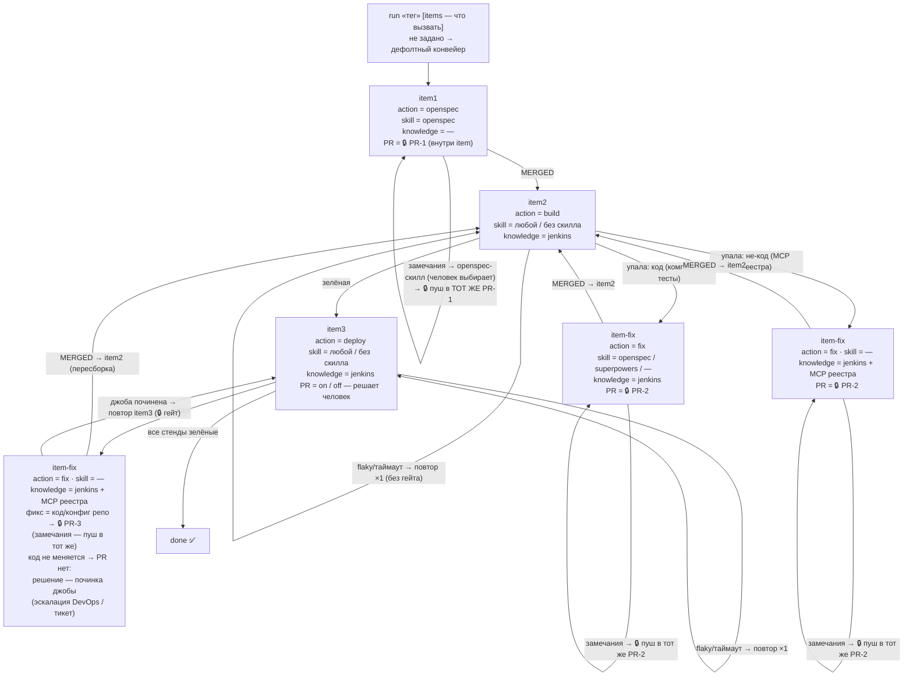
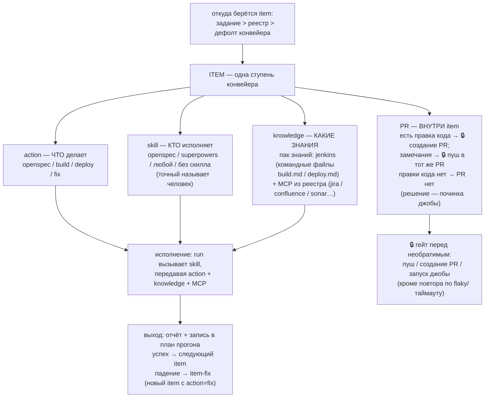

# Исследование архитектуры циклов ship-kit — альтернативы и вердикт

**Дата:** 2026-11-11. **Метод:** три параллельных субагента, только чтение:
R1 — платформенное (OpenSpec, Qwen Code Dynamic Workflows, git-история репо);
R2 — внешние готовые решения паттерна «агент чинит CI → PR»; R3 — готовые
MCP-серверы CI-транспорта. Живость (звёзды/последний push) проверена на
дату через api.github.com (веб-доступ hugin-mcp). gitlab.com/mcp.gitlab.com
из сессии недоступны — единственный по существу непроверенный пункт.

**Вопрос:** ship-kit — это `loop(do→pr) → loop(build→fix) → loop(deploy→fix)`
с общим md-реестром параметров на проекты. Нужен ли рефакторинг, переход на
готовое проверенное решение, или оставить как есть? (План
`dev/ship-kit/plans/2026-11-11-gates-transport-stands.md`, Task 7.)

## Резюме

1. Готовой замены нет: ни одно проверенное решение не покрывает и 70%
   требований — все либо GitHub+GitHub Actions-центричны со своими
   моделями, либо не имеют ни стендов, ни гейтов, ни Bitbucket, ни
   корпоративного Jenkins, ни реестра параметров.
2. OpenSpec (74.6k⭐, MIT, push сегодня) — методология «спека → реализация
   tasks.md → verify», без веток/PR/CI. Взять `loop(do→pr)` не может —
   он уже стоит в правильном месте (`impl=openspec`).
3. Qwen Workflows не тянут главный новый актив — **гейты человека**:
   вопросов пользователю внутри прогона нет и не будет (субагентам
   запрещены ask_user_question/send_message), таймеров и состояния между
   запусками нет, 30 мин wall-clock. Владельцем циклов остаётся скилл `run`.
4. Git-история: удаление `agents/`+`workflows/` (−2577 строк, включая
   обкатанные build-autofix/deploy-autofix) было организационным пивотом,
   не техническим вердиктом. Но требование гейтов (задача 1 плана) даёт
   теперь и технический аргумент против workflows как владельца циклов.
5. Транспортный слой подтверждён: официальные MCP-серверы существуют для
   Jenkins (плагин jenkinsci), GitHub Actions, TeamCity ≥2026.1, Bitbucket
   Cloud (включая ровно наш PR-цикл замечаний); для GitLab — обёртки.
   Контракт «запуск/статус/лог» (задача 3 плана) подтверждается практикой.

**Рекомендация: вариант (в) — оставить скилловое ядро, выполнить задачи 1–6
плана, точечные заимствования без смены архитектуры.**

## 1. Платформенное (R1)

### OpenSpec — Fission-AI/OpenSpec
74 619⭐, MIT, последний push 2026-11-11 (сегодня), сайт openspec.dev.
CLI + генерируемые скиллы: `/opsx:explore → propose → apply → verify → sync
→ archive`; `apply` пишет код по tasks.md с возобновлением, `verify`
валидирует по completeness/correctness/coherence. **Оркестрации выполнения
нет**: ни веток, ни коммитов, ни PR, ни ревью-циклов, ни CI/CD во всём
справочнике. Официальная поддержка Qwen Code (`--tools qwen`, скиллы в
`.qwen/skills/openspec-*/`). Вывод: полезен ровно в сегменте «спека →
реализация tasks.md → verify» — текущая роль в контуре правильная.

### Qwen Code Dynamic Workflows (доки + bundled workflow-authoring)
Умеет: `agent()/parallel()/pipeline()`, schema-ответы, worktree-изоляция,
точечный MCP-доступ на агента (`mcp__<server>__<tool>`), resume по журналу,
бюджет токенов. Ограничения, критичные для владельца циклов:
- **mid-run гейты невозможны**: субагентам навсегда запрещены
  AskUserQuestion/SendMessage/Monitor/Agent; «waiting-approval → ждём
  MERGED → продолжаем» внутри одного прогона невыразимо, только разрывами
  на несколько запусков — а состояния между запусками скрипт не хранит
  (нет FS, таймеров, `Date` запрещён);
- 30 мин wall-clock на прогон (снимается env-переопределением);
  параллельность `max(2, min(16, CPU-2))`;
- включение — только human-input (`ultracode:`/`workflow`), в `qwen -p`
  ключевых слов нет.

Механика `loop(build→fix)` выразима (триггер-агент → поллер → триаж →
фикс в worktree → повтор ≤N) — удалённый `build-autofix.js` это и делал.

### Git-история
`0fc63eb` «заморозка агентов и workflows — приоритет скиллам» → `d067d46`
(удаление 12 агентов + 3 workflow ≈1652 строк JS + док 642 строки) →
`9ea31ce` (зачистка qwen-workflows-доков и стенда). Формулировки всех
коммитов — организационные («пивот», «агентская эпоха»); претензий вида
«workflows не могли X» нет ни в одном. Удалённый же док эпохи
(`workflows-vs-subagents.md`) рекомендовал гибрид «субагенты-исполнители +
Workflow-конвейер». Грабли эпохи (kebab-имена, headless-args строкой,
файловое состояние моков) — интеграционные, не непригодность платформы.

## 2. Внешние решения (R2)

| Решение | Зрелость (2026-11-11) | Покрытие из 10 | Ключевой пробел |
|---|---|---|---|
| github/gh-aw | 5.6k⭐, MIT, push сегодня | ~3 | живёт внутри GitHub Actions; движки Copilot/Claude/Codex/Pi (Qwen не заявлен); нет стендов/Jira/реестра |
| OpenHands → Agent Canvas | 93.2k⭐, MIT, push сегодня | ~3–4 | self-hosted диспетчер агентов/automations; ACP-потенциал для Qwen; без Jenkins/Bitbucket/Jira, гейты — на совести обвязки |
| Copilot Agent Merge («Watch and fix») | GA (2026-10-28) | ~2–3 | GitHub Actions only, модели Microsoft |
| claude-code-action | 9.9k⭐, push 2026-11-10 | ~2 | GitHub only, Anthropic |
| Spec Kit (github/spec-kit) | 149.3k⭐, MIT, сегодня | ~2 | процессы/спеки, не исполняет; qwen-интеграция подтверждена |
| SWE-agent | 20.8k⭐, push 2026-11-09 | ~1 | issue→патч; PR-цикла, гейтов, деплоя нет |
| aider | 50.1k⭐, но push 2026-05-22 (~6 мес тишины) | ~2 | локальные --lint/--auto-test; aider-ci не найден |
| Qodo PR-Agent | 15.9k⭐, MIT, сегодня | ~1–2 | ревью-слой; зато Bitbucket Cloud+Server из коробки |
| CodeRabbit / Graphite Diamond | живые | ~1–2 | ревью/фикс замечаний, не конвейер; Graphite — GitHub only |

Свернулся: Sweep AI (репо переописан). Не подтверждён: Atlassian Rovo Dev
(доки 404).

**Чего нет ни у кого:** деплой-промоушен DEV→ST→IFT→PSI с наследованием
параметров прошлой успешной джобы; корпоративный Jenkins (не GitHub
Actions); обязательные человеческие гейты перед запуском джобы/push как
first-class механика; общий md-реестр параметров на много проектов;
Bitbucket в одном контуре с CI-фиксами.

**Стоит заимствовать:** у gh-aw — модель safe-outputs (пишущие действия
через валидируемые выходы с отдельными permissions) и бюджетные лимиты
`max-turns`/`max-ai-credits` (аналог наших runLimit/runBudget).

## 3. MCP CI-транспорты (R3)

| CI | Сервер | Зрелость | Контракт запуск/статус/лог |
|---|---|---|---|
| Jenkins | **jenkinsci/mcp-server-plugin** (офиц.) | 119⭐, MIT, push 2026-11-09 | ✅ полностью: `triggerBuild(jobFullName, parameters:map)` → queue→build (номер+URL), `getBuild` (result/building), `getBuildLog` (пагинация+хвост), `searchBuildLog`; НО это плагин в контроллер Jenkins |
| GitHub Actions | **github/github-mcp-server** (офиц.) | 34.4k⭐, MIT, сегодня | ✅ 1:1: `run_workflow(ref, inputs)`, `get_workflow_run`, `get_job_logs(tail_lines, failed_only)` |
| TeamCity ≥2026.1 | **JetBrains/teamcity-mcp** (офиц.) | 6⭐, Apache-2.0, сегодня | ✅ через REST-passthrough (`teamcity_rest_get/post`, `teamcity_build_log`) |
| Bitbucket Cloud | **atlassian/atlassian-mcp-server** (офиц., GA) | 1.2k⭐, Apache-2.0, 2026-11-07 | ✅ и PR-контур ровно наш (create/merge/approve, comments add/**resolve**/reopen), и Pipelines CI (run/status/step log) |
| GitLab CI | офиц. не найден (gitlab.com недоступен из сессии — не проверено); jmrplens/gitlab-mcp-server 48⭐, push сегодня | — | ⚠️ обёртка над REST-каталогом (1103 действия, динамические инструменты) — нужна прослойка с типизированными trigger/status/log |

Вывод: alias-механизм и контракт «запуск/статус/лог» (задача 3 плана)
подтверждаются реальными серверами; пинование имён инструментов
(`*.tool.run|.status|.log` в реестре) оправдано — имена у всех разные.

## 4. Покрытие чек-листа требований

| # | Требование | OpenSpec | Qwen WF | gh-aw | OpenHands | Copilot AM | PR-Agent | ship-kit |
|---|---|---|---|---|---|---|---|---|
| 1 | циклы с лимитами/бюджетом | ❌ | ⚠️ (токены+30 мин) | ⚠️ | ⚠️ | ❌ | ❌ | ✅ |
| 2 | гейты человека перед необратимым | ❌ | ⚠️ (нет mid-run) | ⚠️ (sandbox) | ⚠️ | ❌ | ❌ | ✅ (задача 1) |
| 3 | повтор по таймауту без переспрашивания | ❌ | ⚠️ (resume) | ❌ | ❌ | ❌ | ❌ | ✅ (задача 1) |
| 4 | стенды DEV→ST→IFT→PSI, наследование параметров | ❌ | ❌ | ❌ | ❌ | ❌ | ❌ | ✅ (задача 4) |
| 5 | общий файл параметров на проекты | ❌ | ❌ (args) | ❌ | ❌ | ❌ | ❌ | ✅ (реестр) |
| 6 | Jira/Confluence-контекст | ❌ | ⚠️ (MCP у агентов) | ❌ | ⚠️ | ❌ | ❌ | ✅ |
| 7 | Bitbucket PR + цикл замечаний | ❌ | ⚠️ (MCP) | ❌ | ❌ | ❌ | ⚠️ (ревью) | ✅ |
| 8 | push только в рабочие ветки | ❌ | ⚠️ (permissions) | ⚠️ | ⚠️ | ❌ | ❌ | ✅ (задача 1/2) |
| 9 | impl по спеке / прямой | ✅ | ❌ | ❌ | ❌ | ❌ | ❌ | ✅ (задача 2) |
| 10 | работа внутри Qwen Code | ✅ | ✅ | ❌ | ⚠️ (ACP) | ❌ | ⚠️ | ✅ |

## 5. Ограничения проверки

- gitlab.com / mcp.gitlab.com недоступны из сессии — существование
  официального GitLab MCP не подтверждено и не опровергнуто (нужна ручная
  проверка в браузере при появлении GitLab-проекта).
- Движки gh-aw: кастомный `engine.harness` заявлен, Qwen — не проверено.
- Поведение Workflows в headless `qwen -p` — по докам, без эксперимента.
- Отдельные claims помечены «не проверено» в исходных отчётах субагентов.

## 6. Волна 2: абстракция интеграций, порядок вызовов, форк (R4–R6)

### R4 — абстракция внешних систем (alias-слой)
Все зрелые решения пришли к одному паттерну: **явная декларация возможностей
с валидацией до рантайма + escape-hatch для произвольного** (gh-aw —
md-коннекторы с `tools.*` (чтение) и `safe-outputs.*` (запись, лимиты) +
compile-time валидация; OpenHands — event-sources + реестр ACP; Spec Kit —
адаптеры + `generic`). Capability-discovery как основной механизм не
использует никто: описания MCP-инструментов — не контракт, недетерминизм
смертелен для ремонтного цикла. Generic-passthrough ломает least-privilege
и «ничего не искать».

Вывод для ship-kit: alias-слой **остаётся**, но пере-семантизируется из
vendor-алиасов в **роли конвейера**: `ci` (kind build|deploy), `quality`,
`vcs` (PR-хостинг), `tracker`, `knowledge`; запись роли в реестре
расширяется опциональным allowlist инструментов (аналог
`mcp-servers.<name>.allowed` у gh-aw); реестр валидируется при сетапе
(сервер существует, инструменты видны пробом); **контракт деградации** —
роли нет → ступень пропускается с записью в план, а не падает (обобщение
текущего поведения mcp-deploy); discovery (tool_search) — только fallback
внутри уже привязанного сервера. Явная передача ролей аргументами вызова
подтверждена как правильная («importing alone selects nothing» у gh-aw).

### R5 — порядок вызовов ступеней
Макро-порядок `spec → implement → PR → merge → build → deploy` совпадает
с мейнстримом (TBD, Fowler DeploymentPipeline, SDD Spec Kit) —
переупорядочивать каркас не нужно. Находки:

1. **Сборка только после MERGED** — потеря быстрой обратной связи;
   TBD/Fowler предписывают CI-прогон PR-ветки до merge; механика уже есть
   (`trigger_build(job, branch)`).
2. **Скилл review не в цепочке run** — до открытия PR нет ни одного
   автоматического quality-гейта (у Spec Kit: analyze перед implement,
   converge после). Дёшево: implement → review → PR.
3. **Нет converge/verify** результата против спеки (роль неявно тянет
   ревьюер).
4. **Стенды не смоделированы**: индустрия (GitHub environments, Bitbucket
   deployment permissions) — гейт свой на окружение; типовая политика
   DEV/ST авто, IFT/PSI — human approval. Замечание: наше решение 1
   (гейт на КАЖДЫЙ запуск) строже — отдельная политика стендов при нём
   избыточна (см. §7, открытый вопрос).
5. **Артефакт не закреплён**: деплой наследует параметры «прошлой успешной
   джобы», а не «сборки #N этого прогона» — нарушение «only build once».
6. **Нет ретрай-лени**: категория flaky есть в таксономии, поведения нет —
   любой FAILURE = «фикс или стоп»; индустриальный паттерн — один re-run
   as-is с отдельным лимитом.
7. **Нет post-deploy smoke** перед done.
8. Подтверждено хорошим: plan.md-резюм (аналог durability), fixFlow=pr +
   waiting-approval (прямое попадание в Fowler «stage requires human
   authorization»), issues.md, честные лимиты/бюджет. Мелочь: ожидание
   апрува ест runBudget (нет заморозки).

### R6 — форк готовых решений

| Кандидат | Усилие | Вердикт |
|---|---|---|
| gh-aw (github/gh-aw; был agent-workflows) | **L+** | не форкать: ядро прибито к GitHub Actions-раннеру (safe-outputs — отдельные Actions-джобы, компилятор выдаёт Actions YAML); дрейф экстремальный (коммиты ежедневно, релизы отзывают по CVE). Брать идеи: манифесты, safe-outputs, бюджеты |
| PR-Agent (The-PR-Agent/pr-agent, MIT) | **S** (встройка) | не форк — зависимость: провайдеры bitbucket + bitbucket_server встроены, plugin-API регистрируется из своего пакета без правки исходников; LiteLLM-конфиг. Роль: движок /describe /improve для review/pr |
| OpenHands (Agent Canvas) | M–L | не форк (монолит, дрейф); опция на потом — UI-оболочка с Qwen Code по ACP (штатный сценарий) |
| SWE-agent | M | форк возможен, нецелесообразен: остаётся скелет петли, который у нас уже есть |
| Spec Kit | S (extension) | не форк: extensions API; наш openspec-скилл уже закрывает |
| agent-workspace-fabric (dimileeh, Apache-2.0, alpha) | M (оценочно) | единственный кандидат на пилот loop(do→pr): worktree на задачу, PR-monitor, comment-fix, merge-гейты, GitHub+Bitbucket, драйверы агентов (Codex/Claude/Gemini/OpenCode; Qwen — проверить точку расширения). Зрелость не проверена (rate-limit) |

**Вывод R6:** форка, который дешевле имеющихся 9 скиллов (~2k строк
markdown, ноль рантайма), нет. Усилители — как зависимости: PR-Agent (S),
пилот agent-workspace-fabric (требует проверки), OpenHands Canvas как
будущий UI-слой.

## 7. Варианты и рекомендация (после двух волн)

- **(а) Рефакторинг** — готового образца по-прежнему нет; но волна 2 дала
  лёгкие архитектурные правки ВНУТРИ текущего каркаса (роли вместо
  vendor-alias, деградация ступеней, review до PR, ретрай-лень, пиннинг
  артефакта, гейты стендов) — это не смена каркаса, а развитие задач.
- **(б) Переход/форк** — кандидата нет (R2+R6 сходятся); готовое — только
  точечные усилители-зависимости.
- **(в) Оставить + задачи 1–6 + дельта волны 2 — рекомендуется.**

Точечные заимствования без смены архитектуры (из волны 1): справочник
реальных MCP-серверов (§3) в docs; идея safe-outputs — в гейт-карточках
задачи 1; возврат Qwen Workflows как транспорта ступеней — отложенная
опция после обкатки гейтов.

### Дельта к задачам плана (предлагается по итогам волны 2)

1. **Задача 1 (гейты) +=** ретрай-лень: диагноз `flaky`/таймаут → один
   повтор без фикса и без нового гейта; отдельный лимит `retryLimit` в
   реестре; стабильность падения подтверждает диагноз.
2. **Задача 2 (run) +=** ступень `review` до открытия PR
   (request-changes → цикл назад, счётчик fixRetries); заморозка
   runBudget на время ожидания апрува; пиннинг артефакта — деплой
   получает аргументом «сборка #N этого прогона».
3. **Задача 3 (транспорт) +=** пере-семантизация alias в роли конвейера
   (`ci`/`quality`/`vcs`/`tracker`/`knowledge`; `ci` с kind
   build|deploy); опциональный allowlist инструментов на роль;
   проб-валидация реестра при сетапе; контракт деградации — роли нет →
   ступень пропускается с записью в план.
4. **Задача 4 (стенды) +=** политика гейтов стендов (открытый вопрос
   ниже); опциональный post-deploy smoke (read-only health) перед done.
5. **Новая опция:** pre-merge сборка PR-ветки — ключ реестра (например
   `build.pr: on`), быстрая обратная связь до merge.
6. **Вне контура (отдельные решения):** PR-Agent как движок review/describe
   (S); пилот agent-workspace-fabric (alpha, проверить); OpenHands Canvas
   как UI-оболочка с Qwen по ACP.

**Открытый вопрос (R5 vs решение 1):** индустрия — «DEV/ST авто, IFT/PSI
human approval»; решение 1 — гейт на КАЖДЫЙ запуск. Рекомендую оставить
решение 1 (строже, проще, отдельный механизм стендов не нужен);
альтернатива — политика стендов в реестре (`deploy.gate: all|ift-psi`).

## 8. Целевая архитектура — решение пользователя (2026-11-11)

**Принято: вариант (в) оставить скилловое ядро**, с перестройкой конвейера на
**items-модель** (собственный синтез пользователя по итогам обеих волн):
конвейер = последовательность item, каждый item = `item(action, skill,
knowledge, PR)` с независимыми слотами; PR — часть item, не отдельная
ступень; у деплоя PR может отсутствовать — когда исправления кода нет
(решение — починка джобы). Слот `skill` поглощает
прежний `impl`-параметр; слот `knowledge` — командные файлы (бренд CI
живёт в паке знаний, не в скиллах); набор items — конфигурация проекта.

### Схема конвейера (дефолт)

### Анатомия item

### Правила, принятые вместе со схемой

1. Между openspec и «пушем ветки + PR» других скиллов нет.
2. run — диспетчер: аргумент — какой item/скилл вызвать; не указан →
   дефолтный конвейер.
3. Замечания любого PR правятся пушем в тот же PR (🔒); новый PR — только
   на новый фикс после упавшей сборки/деплоя.
4. Код-фиксы (компиляция/тесты/замечания) — openspec-скилл, точный
   называет человек (пауза-вопрос или назван в задании).
5. Не-кодовые падения — диагноз по MCP из реестра + knowledge-пак. Фикс —
   код/конфиг репозитория → PR. У деплоя может отсутствовать исправление
   кода — тогда PR нет вообще: решение в починке самой джобы (эскалация
   DevOps/тикет по диагнозу), затем повтор деплоя (🔒 гейт). Прямого пуша
   без PR нет.
6. Гейты 🔒 (решение 1 волны 1): запуск джобы (каждый, включая каждый
   стенд), любой пуш, создание PR; flaky/таймаут → один повтор без гейта
   (retryLimit — пункт 1 дельты, принят).
7. Целевые ветки запрещены (решение 6): пуш только в рабочие ветки.
8. Стенды DEV→ST→IFT→PSI (решения 9–10): каждый стенд — свой запуск;
   runLimit.deploy — на стенд; runBudget заморожен в ожидании.

### Судьба дельты волны 2

- Пункт 1 (retry-lazy) — **принят**.
- Пункт 2 — **переработан схемой**: review как ступень отклонён (между
  openspec и PR других скиллов нет); заморозка runBudget в ожидании —
  принята; пиннинг артефакта — отложен (не вошёл в схему).
- Пункт 3 — **заменён items-моделью**: knowledge-слот вместо переименования
  alias; контракт деградации не принят (роль определяется item-набором
  проекта); проб-валидация реестра — не вошла.
- Пункт 4 (smoke) и пункт 5 (build.pr) — **не приняты** (в схеме нет;
  остаются будущими опциями).
- Пункт 6 (внешние усилители) — **отменён пользователем**.
- Открытый вопрос по гейтам стендов — **снят**: каждый запуск под гейтом
  (решение 1), отдельная политика стендов не вводится.

## Решение

**Принято (2026-11-11): вариант (в) — оставить скилловое ядро, перестроить
конвейер на items-модель** (`item(action, skill, knowledge, PR)`), см. §8.
План задач перестроен под это решение:
`dev/ship-kit/plans/2026-11-11-gates-transport-stands.md` (v3).
Внешние решения (PR-Agent, agent-workspace-fabric, OpenHands Canvas)
рассмотрены и отклонены; Qwen Workflows как транспорт ступеней — отложенная
опция.

## Исходные отчёты

Полные тексты R1–R6 — в журналах субагентов сессии (task notifications,
2026-11-11); ключевые источники: openspec.dev/docs, qwenlm.github.io/
qwen-code-docs (workflow-mode, workflow-intent), github.com/Fission-AI/
OpenSpec, github/jenkinsci/mcp-server-plugin, github/github-mcp-server,
github/JetBrains/teamcity-mcp, github/atlassian/atlassian-mcp-server,
github/gh-aw, OpenHands/OpenHands, github/spec-kit, The-PR-Agent/pr-agent,
github/dimileeh/agent-workspace-fabric, trunkbaseddevelopment.com,
martinfowler.com/bliki/DeploymentPipeline.html.
