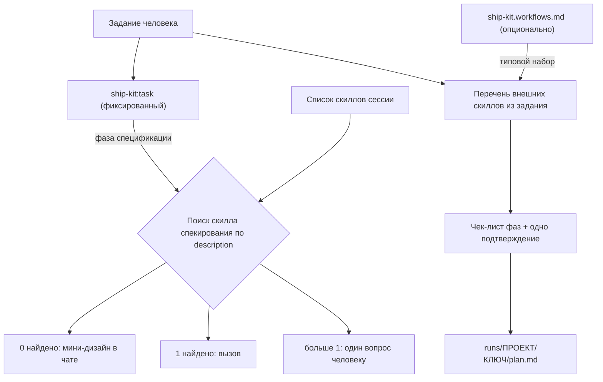
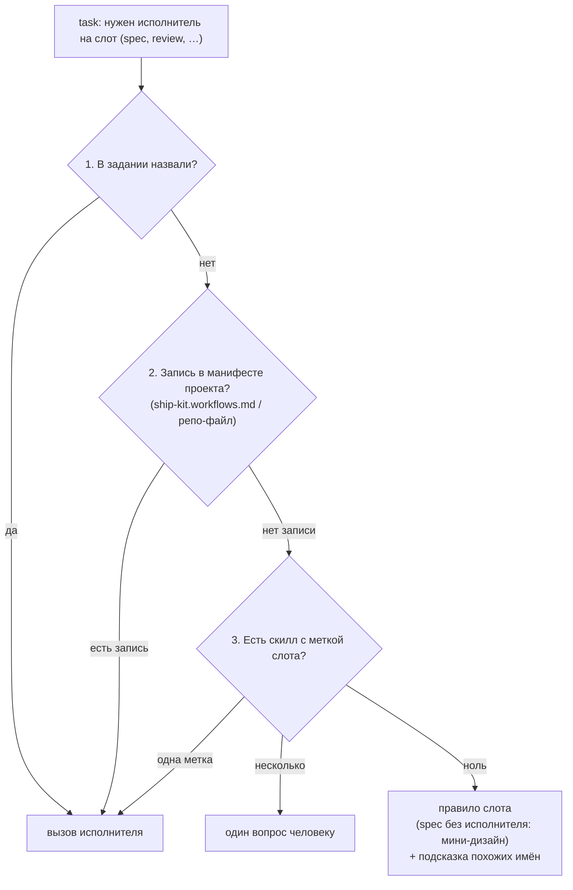

# Исследование: вызов переменного набора скиллов из фиксированного комплекта

Дата: 2026-11-20. Повод: задание пользователя — предложить новые лучшие
идеи, как один набор скиллов (ship-kit, фиксированный) вызывает другой
набор, меняющийся от проекта к проекту; готовые решения искать в
интернете, результат — в каталог исследований, переиспользовать после
подтверждения.

## Вопрос

Как известные системы решают задачу «фиксированный вызыватель →
переменный, зависящий от проекта, исполнитель»: где объявляется связь,
что происходит при отсутствии исполнителя, при нескольких кандидатах,
при несовместимой версии. Что из готового переиспользовать для ship-kit.

## Коротко — простыми словами

Есть комплект скиллов ship-kit (`task`, `pr`, `ci`) — он одинаковый во
всех проектах. Иногда ему нужно позвать скилл, которого в комплекте
нет, и в каждом проекте этот скилл свой (в этом репо это openspec;
где-то будет другой). Сегодня ship-kit ищет такого помощника, читая
тексты описаний всех скиллов сессии и угадывая по смыслу. Мы посмотрели,
как то же самое решают 13 известных систем (VS Code, pre-commit,
Terraform, Claude Code, Qwen Code и др.): никто не угадывает по тексту —
везде либо скилл сам заявляет «я умею X», либо в проекте лежит
файл-список «кого звать», либо все заранее договариваются о понятных
именах. Ниже — подробно, как это устроено у них и что из этого стоит
взять в ship-kit.

## Метод

Веб-чтение официальной документации; делегирование двум cheap-агентам
(glm-5.3-flash, скилл cheap-web-search), 13 систем, все страницы
прочитаны напрямую 2026-11-20.

## As-is: как ship-kit вызывает переменный набор сегодня

Два независимых пути: спека — рантайм-поиск по description; внешние
скиллы — перечень в задании (+ опциональный макрос). Конвенция проекта
может обязывать спеку и называть инструмент (лесенка задание >
конвенция > вопрос).

## Находки — готовые механизмы

| Механизм | Кто использует | Суть | Источник (прочитано 2026-11-20) |
|---|---|---|---|
| Декларация в самом исполнителе (точка расширения) | VS Code `contributes.*` + `activationEvents`; JetBrains `<extensions>` в plugin.xml; Zed `extension.toml` + `languages/*/config.toml`; pre-commit `.pre-commit-hooks.yaml`; Angular `collection.json` | исполнитель декларирует, что предоставляет; вызыватель сканирует установленных и матчит по id/имени точки; код запускается лениво по событию активации | code.visualstudio.com/api/references/contribution-points; plugins.jetbrains.com/docs/intellij/plugin-extensions.html; zed.dev/docs/extensions; pre-commit.com; angular.dev/tools/cli/schematics-authoring |
| Файл-манифест в проекте перечисляет исполнителей | pre-commit `.pre-commit-config.yaml` (`repo`+`rev`+`id`); Terraform `module { source, version }`; MCP `.mcp.json` → `mcpServers`; GitHub Actions `uses: owner/repo/.github/workflows/x.yml@ref` | связь живёт в проекте; пин версии обязателен или естественен (rev, @SHA); GHA: «If a release tag and a branch have the same name, the release tag takes precedence» | pre-commit.com; developer.hashicorp.com/terraform/language/modules/sources; code.claude.com/docs/en/mcp; docs.github.com/en/actions/using-workflows/reusing-workflows |
| Конвенция стабильного имени-слота | husky `.husky/<git-hook>` (исполняет сам git через `core.hooksPath`); just `justfile`; go-task `Taskfile.yml`; Claude Code: commit-инструкции запускают проектный скилл `verify`/`simplify`, если он есть | вызыватель знает только имя-слот; проект решает, что за ним; отсутствие — тихая деградация (husky) или статическая ошибка до запуска (just: «Unknown recipes and circular dependencies are reported before anything runs») | typicode.github.io/husky/; just.systems/man/en/; taskfile.dev; code.claude.com/docs/en/skills |
| Детерминированный каскад приоритетов | Qwen Code скиллы: «the first one found wins: project, then personal, then extension, then bundled»; Claude Code: «Enterprise over personal, and personal over project»; MCP: local > project > user, «fields are not merged across scopes»; `Taskfile.yml` > `Taskfile.dist.yml`; just `fallback` вверх по каталогам | несколько источников не конфликтуют: побеждает запись по таблице; расширения неймспейсятся (`ext:skill`) и сосуществуют | raw.githubusercontent.com/QwenLM/qwen-code (docs/users/features/skills.md); code.claude.com/docs/en/{skills,mcp}; taskfile.dev; just.systems |
| Матчинг по description в рантайме (модель-роутер) | Agent Skills: progressive disclosure — в системный промпт попадают только name+description; «The description is what Claude matches your request against when determining whether to trigger the Skill» | единственный механизм без детерминированного контракта; сама спецификация конфликты не определяет — клиенты добавляют таблицы приоритетов поверх | docs.claude.com/en/docs/agents-and-tools/agent-skills/overview; agentskills.io/specification |

Обработка краёв у зрелых систем. Отсутствие: статическая ошибка до
работы (just), exit-код 200 + fuzzy-подсказка «Did you mean 'build'?»
(go-task), жёсткий отказ продолжать (Terraform init не идёт дальше;
GHA — недоступный nested workflow → fail), «skill was not found»
(Claude Code). Несколько кандидатов: запрет дубликата (VS Code — id
уникальны; just — ошибка, override только явным `allow-duplicate-recipes`),
неймспейсы для сосуществования (Qwen `ext:skill`, плагины Claude),
интерактивный выбор (Nx: «Nx will prompt you to pick between the
installed plugins that provide a generator with that name»), список с
порядком (JetBrains `order`). Версия: `engines.vscode` (semver,
«Cannot be `*`»), `<idea-version since-build/until-build>`, `version:`
Taskfile (нет поля → exit 107), `rev` pre-commit, `@ref` GHA (SHA —
«safest»), lock-файл Terraform. Forward-compat: Zed — «Versions of Zed
that do not support `opt_in_languages` ignore it».

## Ключевой вывод

Пять стратегий объявления связи «фиксированный вызыватель → переменный
исполнитель»: **(а) декларация в исполнителе** (точка расширения),
**(б) манифест в проекте** (пин по имени и версии), **(в) конвенция
стабильного имени-слота**, **(г) детерминированный каскад приоритетов**
поверх любых источников, **(д) матчинг по description**. Рантайм-поиск
по description как единственный механизм не использует никто: там, где
он есть (Agent Skills), поверх него клиенты строят детерминированные
таблицы резолюции. Минимальная рабочая пара — слот-конвенция + каскад:
вызыватель знает только нейтральное имя роли, проект решает, что за
ним, ноль/несколько кандидатов обрабатываются явными правилами.

Перевод на простой язык: «декларация в исполнителе» = скилл сам пишет
в своём файле, за что он отвечает; «манифест в проекте» = в проекте
лежит файл-список, кого звать; «конвенция имени-слота» = все
договариваются о понятных именах-«розетках», и вызыватель зовёт по
имени; «каскад приоритетов» = фиксированный порядок, откуда брать
ответ, если подходящих мест несколько; «матчинг по description» =
угадывание по тексту описания — как сегодня у ship-kit.

## Идеи для ship-kit — подробно и простыми словами

Договоримся о словах (понадобятся ниже):

- **Комплект** — ship-kit: скиллы `task`, `pr`, `ci`. Ставится во все
  проекты одинаково.
- **Переменный набор** — скиллы проекта, которых в комплекте нет: в
  этом репо это openspec-скиллы, в другом проекте — какие-то другие.
- **Слот** — «розетка» с понятным именем, например `spec` («скилл,
  который делает спецификацию») или `review`. ship-kit знает только
  имя розетки; какой скилл в неё «воткнуть» — решает проект. Так уже
  устроены MCP-роли комплекта (tracker, docs, repo, …).
- **Метка** — явная запись в SKILL.md переменного скилла вида «я
  закрываю слот такой-то».
- **Манифест** — файл в проекте со списком «на какую фазу кого звать».
- **Каскад** — фиксированный порядок поиска исполнителя: задание →
  манифест → метки скиллов → вопрос человеку.

### Как это работает сегодня (живой пример)

Команда: `/ship-kit:task PRJ-42 добавь экспорт CSV` в этом репо.

1. `task` видит, что по конвенции проекта нужна спецификация.
2. Читает список всех скиллов сессии и **пытается угадать по тексту
   описания**, кто из них — инструмент спекирования (здесь это
   `openspec-propose`).
3. Угадал одного — зовёт. Никого — делает мини-дизайн сам, в чате.
   Нескольких — задаёт один вопрос.

Что плохо: угадывание по тексту хрупкое (поменялась формулировка
description — поиск сломался); внешние скиллы идут вообще другим путём
(их надо перечислять в задании руками); два механизма вместо одного.

### Идея 1 — «розетки» с понятными именами (слоты)

**Суть.** `task` больше не ищет «скилл спекирования по смыслу», а
зовёт слот `spec`. Что стоит за слотом — решает проект.

**Как будет выглядеть.** В конвенции проекта (репо-файл) написано
«spec = openspec-propose» — `task` зовёт именно его. В другом проекте
написано «spec = my-spec-tool» — позовут его.

**Что это даёт.** Имя конкретного инструмента не попадает в файлы
комплекта (действующий инвариант); поведение одинаково во всех
проектах; легко объяснять.

**Цена.** Завести и поддерживать словарь слотов (какие бывают: `spec`,
`review`, …) — по аналогии со словарём MCP-ролей.

### Идея 2 — скилл сам заявляет, за что он отвечает (метка)

**Суть.** Переменный скилл пишет в своём SKILL.md «я закрываю слот
`spec`». `task` ищет явную метку, а не угадывает по описанию.

**Как будет выглядеть.** В SKILL.md скилла `openspec-propose`
появляется строка «слоты: spec». `task` сканирует скиллы сессии,
находит метку — зовёт. Меток на один слот оказалось две — не угадывает,
а спрашивает одним вопросом.

**Кто так делает.** VS Code (каждое расширение в манифесте
package.json перечисляет, что оно добавляет), pre-commit (у репозитория
с хуками обязан быть файл `.pre-commit-hooks.yaml` с перечнем хуков),
JetBrains (в plugin.xml перечисляются точки расширения).

**Цена.** Автор переменного скилла ставит одну строку. Для чужих
скиллов без метки — откат к нынешнему угадыванию или вопрос.

### Идея 3 — файл-список в проекте (манифест)

**Суть.** В проекте лежит файл, где перечислено «фаза → кого звать».
Сегодняшний опциональный макрос `ship-kit.workflows.md` — почти это;
идея в том, чтобы сделать его главным механизмом, а не опцией.

**Как будет выглядеть.** В `ship-kit.workflows.md` написан типовой
набор «standard: spec, review» — `task` разворачивает его в чек-лист
фаз и никого не спрашивает.

**Кто так делает.** pre-commit (`.pre-commit-config.yaml` в проекте
перечисляет хуки с пином версии), MCP (`.mcp.json` перечисляет
серверы), Terraform (блоки `module` с source и version).

**Цена.** Ещё один файл в проекте. Для простых случаев он не нужен —
каскад из идеи 4 продолжает поиск дальше.

### Идея 4 — один порядок поиска вместо двух (каскад)

**Суть.** Сегодня спека ищется по описанию, а внешние скиллы —
перечислением в задании. Идея: один порядок на все случаи:

1. в задании назвали — зовём названного;
2. есть запись в манифесте проекта — зовём по записи;
3. есть скилл с меткой слота — зовём его;
4. никого — один вопрос человеку; а если у слота есть правило «без
   исполнителя» (например, spec → мини-дизайн) — действуем по правилу.

**Кто так делает.** Qwen Code (скиллы: проект → пользователь →
расширение → встроенные), Claude Code (enterprise → personal →
project), MCP (local → project → user; записи не сливаются — побеждает
целиком запись из более приоритетного источника).

**Цена.** Самая большая правка: перестроить Шаг-0 `task`. Зато после
неё всё вызывается по одному алгоритму.

### Идея 5 — внятные сообщения, когда никого не нашли

**Суть.** Если исполнителя нет — не молчать (git молча пропускает
отсутствующий хук husky), а сказать прямо: «слот `spec` не найден;
похожие скиллы: openspec-propose, openspec-explore — уточните, иначе
будет мини-дизайн». И весь чек-лист проверять сразу на Шаге-0, до
начала работы.

**Кто так делает.** just («неизвестные рецепты сообщаются до того, как
что-либо запущено»), go-task (код ошибки + подсказка «Did you mean
'build'?»).

**Цена.** Маленькая; это качество диагностики, а не новый механизм.

### Идея 6 — старое и новое не ломают друг друга

**Суть.** Правило для форматов меток и манифеста: неизвестные поля
игнорируются. Если в проекте появится новое поле, которого старый
ship-kit не знает, — он его молча пропустит, а не упадёт.

**Кто так делает.** Zed («версии Zed без поддержки `opt_in_languages`
просто игнорируют это поле»).

**Цена.** Не отдельная фича, а дисциплина при проектировании формата.

### Сводно

| # | Идея | Что меняется на практике | Цена |
|---|---|---|---|
| 1 | Слоты | `task` зовёт «spec», а не угадывает по описанию | словарь слотов в доках |
| 2 | Метка в SKILL.md | скилл сам заявляет «я — spec» | строка у автора скилла |
| 3 | Манифест в проекте | файл «фаза → кого звать» в проекте | опциональный файл |
| 4 | Каскад | один порядок поиска для всех фаз | перестройка Шага-0 |
| 5 | Диагностика | понятные сообщения, проверка заранее | маленькая |
| 6 | Совместимость | старое/новое не ломают друг друга | дисциплина |

**Рекомендация.** Ядро — 1+2+4 (слоты, метки, единый порядок поиска):
они закрывают главную слабость — угадывание по тексту. Манифест (3) —
когда захочется типовых наборов на команду; диагностика (5) логично
идёт вместе с 4; правило 6 применяется автоматически при проектировании
формата. Обёртки-шлюзы в каждом проекте (копировать логику комплекта в
проект, как делал старый husky) не предлагаем — это след в каждом
проекте, против которого уже приняли решение (research/upgrade-config-sync);
неймспейсы `ext:skill` и так дают сосуществование наборов без обёрток.

## Предупреждение

Снимок зафиксирован на дату выше; документация продуктов меняется —
перед опорой на детали сверять с живыми страницами.
