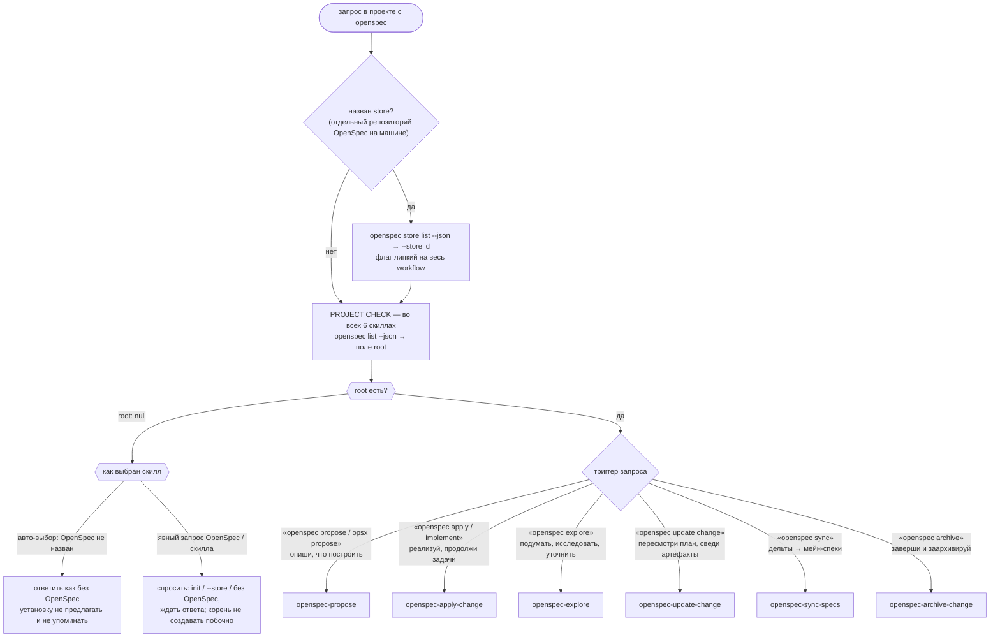
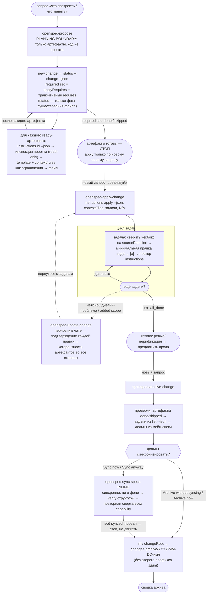
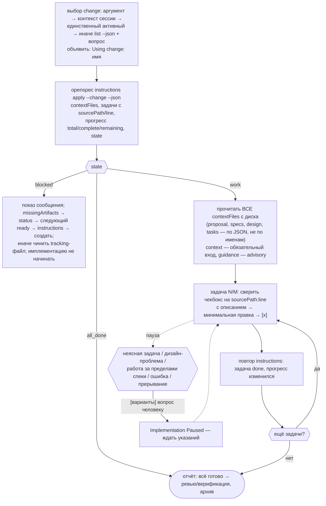
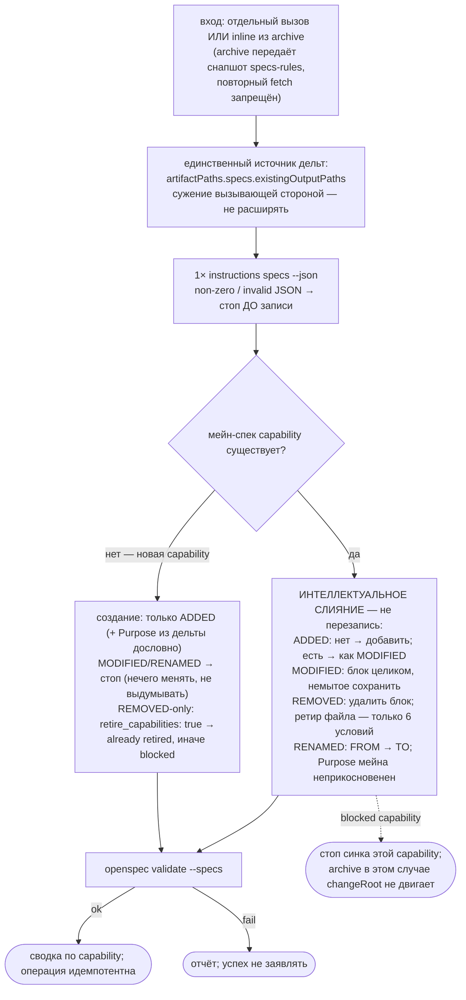
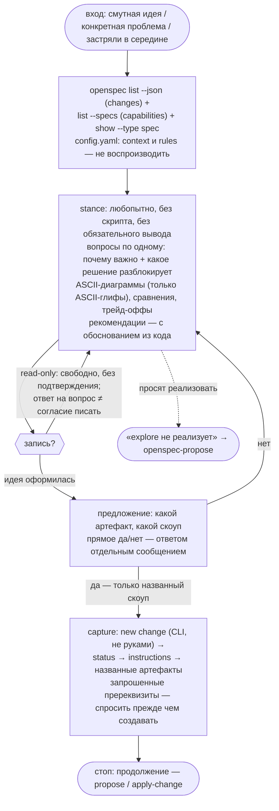
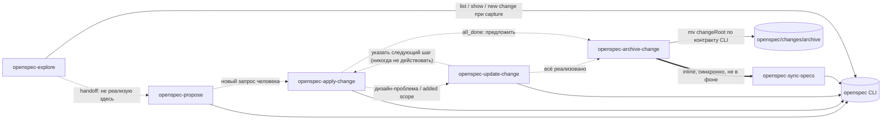

# Схемы взаимодействия скиллов openspec

Дата исследования: 2026-11-18. Источник: `.agents/skills/openspec-*` (генерация openspec CLI 2.0.0, `generatedBy: "2.0.0"`).
Снимок исходников — в `skills/` рядом с этим файлом. Диаграммы составлены по содержимому SKILL.md; mermaid рендерится в Obsidian / Gitea / GitHub.

Диспетчера (аналога `using-superpowers`) в наборе нет: маршрутизация — по description/триггерам, а общий входной контроль (Store selection + Project check) повторён дословно в каждом из шести скиллов.

## 1. Вход и входной контроль (общие блоки всех скиллов)

Отдельный случай `root: null`: ошибка `status`, начинающаяся с `Declared in` / `Invalid store declaration in`, означает «проект объявил store, который машина не разрешила» — это не «не инициализирован», стоп с показом `message` и `fix`.

## 2. Жизненный цикл change

Эксплорация (`openspec-explore`) стоит сбоку от цикла: это режим мышления до/во время change с точкой входа «capture» — см. схему 5.

## 3. Цикл задачи в openspec-apply-change

Правило чекбокса: `[x]` только при полной реализации указанного поведения — не при частичной и не при отложенной; молча сузить/отложить/принять исключение нельзя — вынести добавленный скоуп и спросить.

## 4. Синхронизация дельт (openspec-sync-specs, в т.ч. inline из archive)

Шесть условий ретира (удаления `spec.md`): этот прогон убрал последние требования; спек корректен (остался `## Purpose`); файл не был пуст до синка; все строки учтены каноном; `.openspec.yaml` объявляет `retire_capabilities: true`; путь внутри реального корня specs (без symlink наружу).

## 5. Explore-режим — stance, а не workflow

Правила stance: не реализовывать (в т.ч. не трогать схемы/шаблоны/config.yaml — это change), не выдумывать понимание, не торопить, не навязывать структуру, не автозахватывать инсайты, changes/ руками не создавать.

## 6. Граф вызовов скилл-комплекта

Сплошные стрелки — фактические вызовы внутри одного скилла; пунктир — переходы/handoff (всегда через новое действие человека, кроме inline-sync из archive); жирная — единственный вызов скилла скиллом.

## Матрица взаимодействий

| Скилл | Роль | Явно вызывает | Ключевые артефакты |
|---|---|---|---|
| openspec-explore | мышление | CLI: `list`, `list --specs`, `show --type spec`, `new change` + `instructions` при capture; handoff → propose / apply | артефакты capture, названные запросом |
| openspec-propose | планирование | CLI: `context`, `new change`, `status`, `instructions <artifact>`, `schemas` (по запросу) | `changes/<имя>/`: proposal.md, specs/<capability>/spec.md (дельта), design.md, tasks.md |
| openspec-update-change | ревизия | CLI: `list`, `status`, `instructions` | правки `existingOutputPaths` артефактов (+ файл под частично заполненный glob) |
| openspec-apply-change | исполнение | CLI: `list`, `status`, `instructions apply` | `[x]` в tasks-артефакте, код проекта |
| openspec-sync-specs | спеки-контур | CLI: `status`, `instructions specs`, `validate --specs` | `openspec/specs/<capability>/spec.md` |
| openspec-archive-change | завершение | CLI: `instructions archive` (advisory) / `specs`; INLINE openspec-sync-specs; `mkdir`+`mv` | `changes/archive/YYYY-MM-DD-<имя>/` |

Общий контракт с CLI у всех: `store list --json` и `list --json` (project check) на входе; JSON-статусы (`status`, `instructions`, `list`) — единственный источник истины о состоянии; `context`/`operationGuidance` — advisory-вход, не доказательство готовности.

## Человеко-гейты

| # | Гейт | Где |
|---|---|---|
| 1 | Без root ни одной записи; `openspec init` / `--store` — только по явному ответу человека; корень не создаётся побочно ни одной командой | Project check, все 6 |
| 2 | Planning boundary: после артефактов стоп; apply — только новый явный запрос, даже если исходный запрос просил «построить» | propose |
| 3 | Материальная неоднозначность (скоуп, наблюдаемое поведение, совместимость, критерии приёмки) — вопрос до создания change; мелочи — допущение с записью в артефакт | propose |
| 4 | Запись в explore — прямое да/нет отдельным сообщением на названный скоуп; ответ на вопрос ≠ согласие писать; подтверждение не расширяет скоуп | explore |
| 5 | Каждая правка артефакта — подтверждение до записи (черновик в чате); смена интеншена change → отдельный новый change (Update vs Start Fresh) | update-change |
| 6 | Пауза при неясной задаче / дизайн-проблеме / работе за пределами спеки; `[x]` только при полной реализации — молча не сужать, не откладывать, не принимать исключения | apply-change |
| 7 | Архив с незавершёнными артефактами/задачами — только после подтверждения; выбор синка: Sync now / Archive without syncing / Cancel; отказ от выбора — не архивировать | archive-change |
| 8 | Стоп на blocked capability до записи мейн-спека; ретир capability только при `retire_capabilities: true`; пустую секцию `## Requirements` не оставлять | sync-specs |
