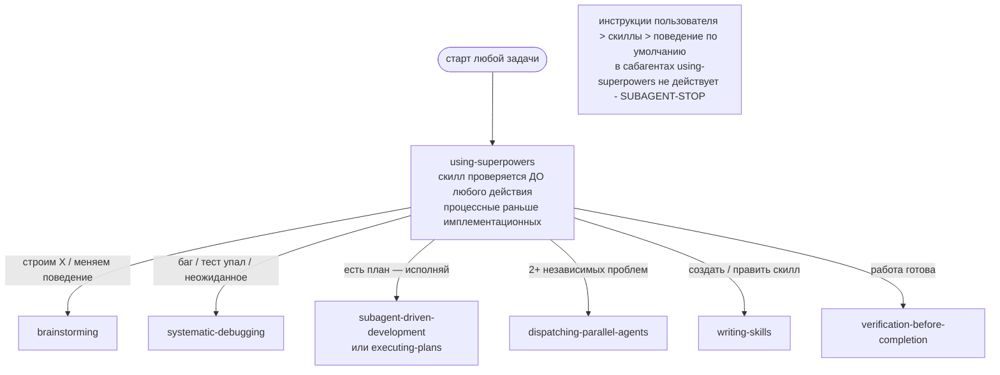
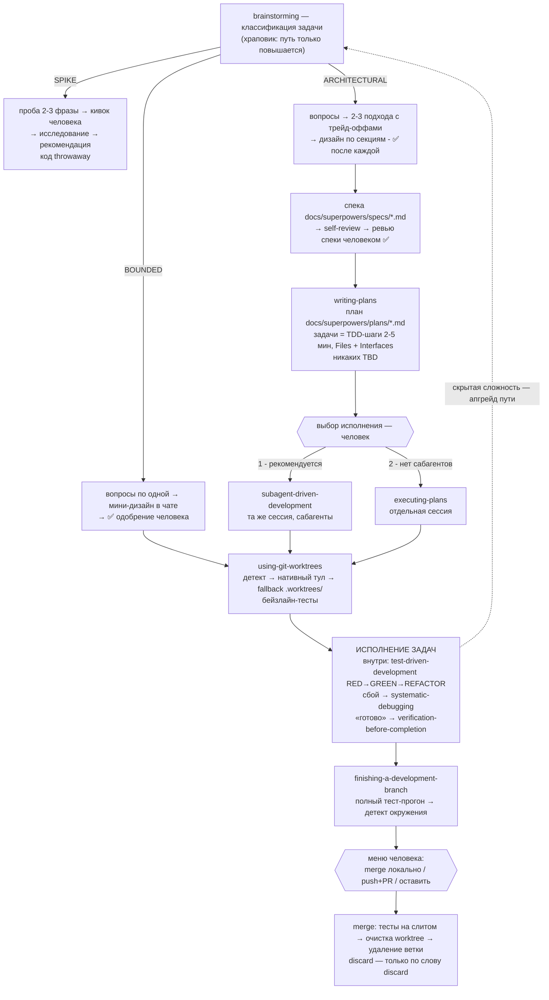
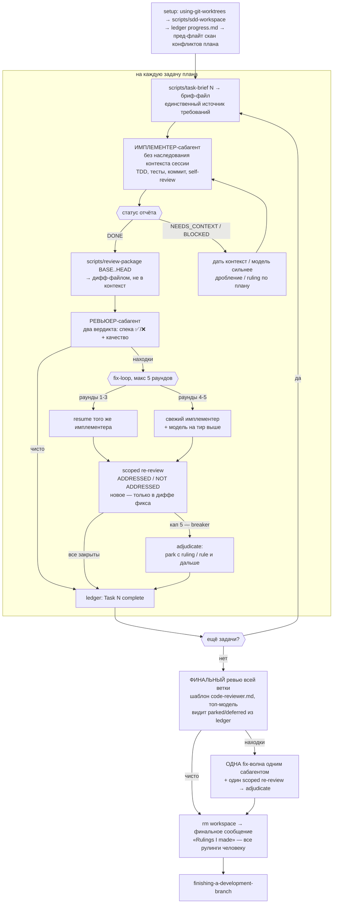
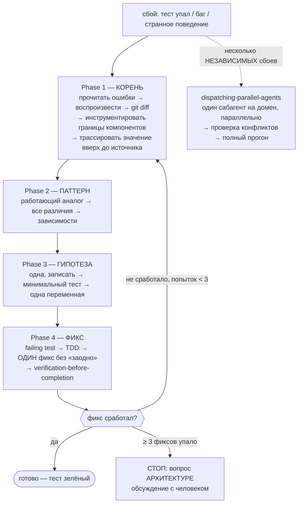
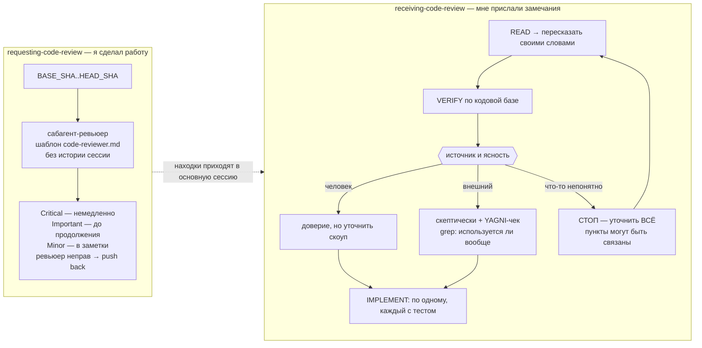
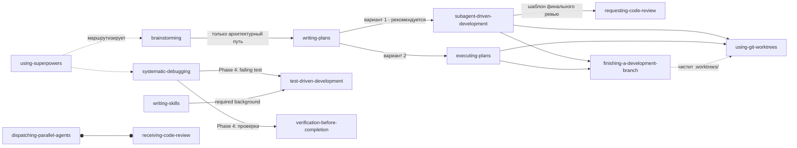

# Схемы взаимодействия скиллов суперпауэрс

Дата исследования: 2026-11-14. Источник: `~/.qwen/skills/` (obra/superpowers, установлены 2026-09-09).
Снимок исходников — в `skills/` рядом с этим файлом. Диаграммы составлены по содержимому SKILL.md; mermaid рендерится в Obsidian / Gitea / GitHub.

## 1. Вход и маршрутизация (`using-superpowers`)

## 2. Жизненный цикл фичи

## 3. Цикл задачи в subagent-driven-development

## 4. Сбойный путь (`systematic-debugging`)

## 5. Ревью-контуры

## 6. Граф вызовов скилл-комплекта

## Матрица взаимодействий

| Скилл | Роль | Явно вызывает | Ключевые артефакты |
|---|---|---|---|
| using-superpowers | диспетчер | направляет на процессные | — |
| brainstorming | дизайн | writing-plans (только арх. путь) | `docs/superpowers/specs/*.md` |
| writing-plans | план | subagent-driven-development \| executing-plans | `docs/superpowers/plans/*.md` |
| subagent-driven-development | исполнение | using-git-worktrees, requesting-code-review (шаблон), finishing-a-development-branch | `.superpowers/sdd/<план>/`: ledger, брифы, пакеты ревью |
| executing-plans | исполнение | using-git-worktrees, finishing-a-development-branch | — |
| using-git-worktrees | изоляция | нативный тул или git | `.worktrees/<ветка>` |
| test-driven-development | дисциплина | — | тест → код → коммит |
| systematic-debugging | дисциплина | test-driven-development, verification-before-completion | failing test |
| verification-before-completion | дисциплина | — | свежий вывод команд |
| requesting-code-review | качество | сабагент-ревьюер | — |
| receiving-code-review | качество | — | — |
| finishing-a-development-branch | завершение | — (чистит worktrees суперпауэрса) | merge / PR |
| dispatching-parallel-agents | ортогональный | — | — |
| writing-skills | мета | test-driven-development (required background) | новый скилл (TDD: baseline-RED → скилл-GREEN → REFACTOR) |

## Человеко-гейты

| # | Гейт | Где |
|---|---|---|
| 1 | Одобрение дизайна до кода (на всех путях, даже bounded — «две фразы, но одобри») | brainstorming HARD GATE |
| 2 | Ревью написанной спеки | brainstorming |
| 3 | Выбор: сабагенты vs inline | writing-plans handoff |
| 4 | Согласие на worktree (если нет объявленного предпочтения) | using-git-worktrees |
| 5 | Четыре стопа SDD: необратимое, безопасность, side-effect наружу worktree, план сломан | subagent-driven-development |
| 6 | 3+ неудачных фикса → вопрос архитектуры | systematic-debugging |
| 7 | Меню merge / PR / оставить; discard только по слову «discard» | finishing-a-development-branch |
