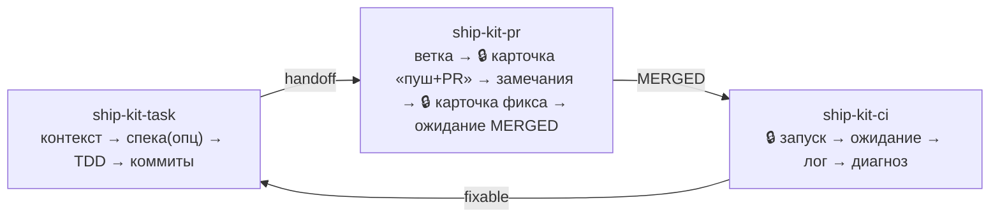

# ship-kit — базовый комплект

Три скилла-фазы: `ship-kit-task` (разработка), `ship-kit-pr`
(доставка), `ship-kit-ci` (сборка/деплой). Работают без какой-либо
конфигурации проекта. Поставка — три самодостаточных каталога
`skills/`; установка — копией выбранных каталогов (можно не всем
набором), скиллы видимы модели и человеку.



## Установка

Скопируй нужные каталоги скиллов в целевую директорию:

```bash
cp -r skills/ship-kit-task skills/ship-kit-pr skills/ship-kit-ci ~/.qwen/skills/   # персональные (все проекты)
# или в проект:  cp -r skills/ship-kit-* <проект>/.qwen/skills/
# частично:      cp -r skills/ship-kit-ci ~/.qwen/skills/   # только «дай лог»
```

Каждый каталог самодостаточен: SKILL.md фазы + `reference.md`
общих инвариантов (у ci — kind-файлы `build.md`/`deploy.md`);
ставится без остальных фаз — план прогона строится из установленных,
отсутствующие помечаются «фаза не установлена». Обновление —
повторная копия поверх. Каталог и файла проектов, и QWEN.md-контекста
в поставке нет: правила грузятся при вызванном скилле, видимость фаз —
обычная (description в списке скиллов сессии; модель ведёт цепочку
плана сама).

## Вызовы

```
/ship-kit-task PRJ-42 добавь экспорт CSV, mcp-tracker=jira-corp, mcp-docs=wiki
/ship-kit-pr отправь на ревью, mcp-repo=bb
/ship-kit-ci запусти сборку export-build, mcp-build=jenkins-corp
```

MCP-алиасы передаются аргументами вызова и сверяются с
`settings.json → mcpServers` проекта; чего не передали — того в
проекте нет (или спросит человека). Возобновление — «продолжи
PRJ-42» (канонический вход `ship-kit-task`).

## Как это работает

1. **Фаза целиком за один вызов**: один Шаг-0 (проверка MCP, сборка
   порядка прогона) — основная работа — один контракт отчёта с
   дословными доказательствами. Цепочка слотов утверждённого плана
   ведётся моделью без остановки (внешние скиллы и фазы комплекта);
   переход между вызовами — человек одной короткой фразой: пока план
   не закрыт, отчёт завершается строкой `ДАЛЬШЕ: продолжи <КЛЮЧ>`.
2. **Гейты 🔒 — три правила**: карточка-превью → явное «да» → действие;
   отказ = стоп; «подтверждаю …» в задании = pre-approved. Пуш+PR —
   одной карточкой; цикл фикса (ответы на замечания + пуш + resolve) —
   одной; каждый запуск джобы — своей. Есть в сессии инструмент вопроса
   с закрытыми опциями — гейт спрашивается им: согласие = выбор
   опции, текст вне опций — не подтверждение. Инструмента нет —
   текстовый канал: подтверждение = дословная фраза целиком из списка
   (да · ок · подтверждаю · подтверждаю <действие>); отказ — нет ·
   стоп; прочее — переспрос один раз, затем стоп. Замечания и
   unresolved считаются только по чужим комментариям — свои
   распознаются по id-журналу плана прогона, авторы из списка
   игнорирования (агенты-ревьюеры: задание `ignore-authors=` +
   конвенция проекта) пропускаются; подписей в PR нет.
3. **Внешние скиллы и порядок**: задание перечисляет скиллы —
   вызванный скилл собирает чек-лист (перечисление + слоты фаз) и
   подтверждает его один раз; гейт PR стоит на строке слота
   `ship-kit-pr`. Типовые наборы — макросом `ship-kit.workflows.md`
   (опционально, формат — именованные md-списки); профиль назван, а
   макроса/секции нет — пометка и один вопрос, молчаливого дефолта
   нет.
4. **Спецификация** — исполнителем слота `spec`. Словарь слотов — как
   словарь MCP-ролей, канонические слоты: `spec`, `business`,
   `technical`; исполнитель заявляет слот меткой `slot:<имя>` в
   description своего SKILL.md (несколько — через запятую; метка
   читается дословно, по смыслу описания исполнитель не подбирается;
   неизвестные слоты игнорируются); метка слота типа (`business` /
   `technical`) означает членство в наборе типа, а не исполнение
   единственной роли.
   Разрешение каскадом: задание > конвенция проекта (обязывает спеку,
   назначает слот или перечисляет набор кандидатов — тогда один
   вопрос) > метки скиллов сессии (несколько — один вопрос); ноль —
   мини-дизайн в чате. Аргументы вызова — лесенкой задание >
   конвенция проекта > вопрос.
   **Типы задач**: `ship-kit-task` на Шаге-0 определяет тип —
   `business` или `technical` — каскадом: дословный маркер
   `(business)` / `(technical)` в задании > поле/лейбл тикета трекера >
   правило конвенции > дефолт `business`; задача выполняется набором
   типа (метки слота либо список конвенции — конвенция сильнее;
   перечень задания сильнее набора типа). Пустой набор: `technical` —
   правка без применения скиллов, без вопроса; `business` — один
   вопрос человеку (бизнес-задачи обычно идут через скиллы). Смешанная
   задача расщепляется в плане прогона на части с типами, тикет не
   делится; тип, источник и состав набора — строкой в плане и отчёте.
5. **Падение CI**: `ship-kit-ci` разбирает лог по kind-файлу
   (build/deploy), даёт категорию/fixable/связанность; связанный фикс —
   в тот же PR, посторонний — тех-ветка от базовой и отдельный PR
   (артефакты спеки не трогаются), не-код — `issues.md` + эскалация
   человеку.
6. **Состояние** — план-файл прогона: **директория каскадом задание →
   конвенция проекта → дефолт — временная `.qwen/tmp/ship-kit/<КЛЮЧ>/`
   проекта** (определённая директория несёт уровень проекта:
   `<директория>/<ПРОЕКТ>/<КЛЮЧ>/`); `issues.md` — рядом; каждый запуск
   материализует план (найти по ключу или создать — любая фаза
   входная); журнал — записи с даты и времени `ГГГГ-ММ-ДД ЧЧ:ММ`;
   план по умолчанию = установленные фазы (`task → pr 🔒 → ci 🔒`;
   фазы комплекта ищутся в списке скиллов сессии, неустановленные
   помечаются). Завершённый прогон архивируется в
   `<корень>/archive/<КЛЮЧ>/` (дефолтный корень — временный, с
   пометкой); `ship-kit-pr` после создания PR ждёт MERGED опросом
   статуса (дефолт 10 сек; интервал — задание `poll=<сек>` >
   конвенция проекта); «продолжи PRJ-42» — канонический вход
   (`ship-kit-task`): остаток плана одним блоком → одно подтверждение
   → слоты ведутся сами; после закрытия слота `spec` — пауза-ревью
   спеки; план живой: тех-PR дописывается слотом `pr: тех-PR`,
   повтор ci — попыткой ×N, дописывание показывается на ближайшей
   карточке/вопросе.
7. **Файл проектов — каскадом**: конвенция проекта может жить в двух
   представлениях — файл проекта в репо (мастер, правится руками
   только он) и центральный каталог всех проектов (автособираемый
   индекс, руками не правится). Разрешение: **задание > репо-файл
   (cwd) > каталог > один вопрос**; одно имя в обоих — действует
   репо-файл. Запись назвала репозиторий (SSH), а cwd — не он:
   `ship-kit-task` клонирует и работает в клоне. Образец каталога с
   генератором индекса — `examples/central-catalog/` в корне репо.

## Границы

- Пуш — только в рабочие ветки `<X>/<КЛЮЧ>`; целевые ветки запрещены.
- Статусы задач трекера не меняются; «ничего не искать».
- Правки репозитория — только через PR.

## Чек-лист адаптации под проект

1. MCP-серверы проекта в `settings.json → mcpServers`; CI даёт контракт
   «запуск/статус/лог».
2. Push-политика: рабочие ветки разрешены, целевые запрещены.
3. Каталог прогонов: по умолчанию ничего не нужно — план живёт во
   `.qwen/tmp/ship-kit/` (вне репо); конвенция может назвать
   постоянный корень (например `runs/`) — тогда `runs/` в
   `.gitignore` проекта.
4. `permissions.allow` в settings проекта для MCP-инструментов и
   рабочих команд (git/<CLI спек-инструмента проекта>/node) — иначе
   терминал будет спрашивать разрешение на каждом шаге.
5. (Опционально) макрос `ship-kit.workflows.md` с типовыми наборами
   скиллов проекта.
6. (Опционально) файл проектов: репо-файл в каждом репозитории —
   мастер; для команды с общей картиной — центральный каталог-индекс
   (генератор — образец `examples/central-catalog/`).
7. Сложные случаи (многостадийный конвейер с лимитами) — образец
   `examples/conveyor/` в корне репо.
8. Обновление комплекта: рецепты по версиям — `docs/upgrade.md`,
   читаются человеком при переустановке (change, меняющий проектные
   ожидания или поведение Шага-0, бампает номер версии секции и
   добавляет раздел рецептов).
