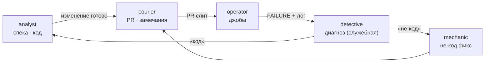
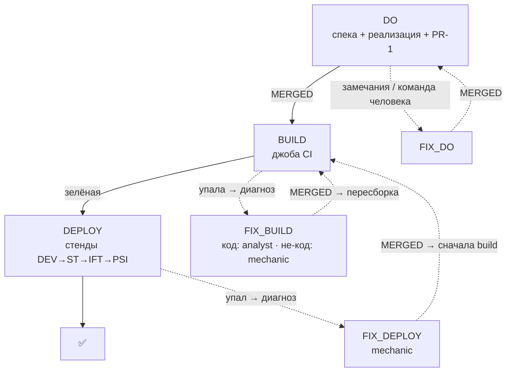
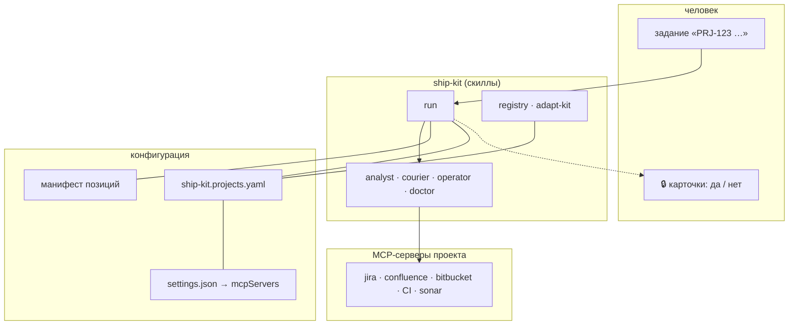

# Эталон: скиллы ship-kit (v2, стадийная модель)

Комплект из **7 скиллов** для конвейера «Jira → OpenSpec → правки → PR →
ревью → сборка → деплой → исправление» на стадийной модели с позициями
исполнителей и записями знания.

Репозиторий сам является **расширением Qwen Code `ship-kit`** (манифест
`qwen-extension.json` в корне, ресурсы в `skills/` и `docs/`; openspec-слой
проекта — в `openspec/`). Установка — `qwen extensions install <git-url>` или
`qwen extensions link <путь>`; скиллы доступны как `/ship-kit:<имя>`.
Обязательные правила любой доработки — скилл
[skills/adapt-kit/SKILL.md](../skills/adapt-kit/SKILL.md).

## 1. Состав (эталон расширения)

```
qwen-extension.json      манифест (name, version)
QWEN.md                  контекст расширения (шпаргалка)
skills/                  7 скиллов контура
  run/                   диспетчер стадийного конвейера
  registry/              ведение ship-kit.projects.yaml (+ миграции формата)
  adapt-kit/             правила доработки комплекта
  analyst/               спека + правки кода (позиция analyst)
  courier/               ветка, PR, замечания (позиция courier)
  operator/              запуск/ожидание джоб (позиция operator)
  doctor/                диагноз + не-код фикс (позиции detective/mechanic,
                         режимы diagnose | fix) + командные файлы build|deploy
docs/
  ship-kit.md            этот документ
  ship-kit.projects.example.md   схема yaml-реестра + пример
  ship-kit.positions.yaml        манифест позиций (словарь исполнителей)
openspec/                per-project корень OpenSpec (changes/specs)
```

Воркспейс разработки (тот же git-репозиторий, вне эталона): `dev/ship-kit/`
— валидатор реестра, e2e-стенд (моки MCP, bare+клон), протоколы прогонов.

## 2. Семь скиллов («Профессии»)

| Скилл | Что делает | MCP (из аргументов вызова) |
|---|---|---|
| `run` | Диспетчер: «тег [стадию/скилл] задание», обход `pipelineOrder`, переходы `nextStageId`/`fixesStageId`/`triggeredBy`, счётчики по id стадии, loop guard, карточки гейтов, план `skill-runs/<тег>/`, WAIT/resume | читает yaml-реестр; исполнителям передаёт их alias |
| `registry` | Единственная точка ведения `ship-kit.projects.yaml`: проекты, стадии, записи знания, servers, executors; валидация; миграции `formatVersion` | — |
| `adapt-kit` | Правила доработки комплекта (точки адаптации, инварианты, критерии) | — |
| `analyst` | Контекст (jira/confluence/mmap) + OpenSpec-изменение + реализация + код-фиксы | mcp-jira, mcp-confluence, mcp-mmap, mcp-bitbucket |
| `courier` | Ветка `<X>/<КЛЮЧ>`, коммиты, 🔒 карточка «пуш+PR», цикл замечаний | mcp-jira, mcp-bitbucket |
| `operator` | Запуск (🔒 карточка) и ожидание (статус/лог/eta/possiblyStuck) | mcp-build, mcp-deploy |
| `doctor` | Режим `diagnose`: категория/fixable/fixHint/knownIssues/confidence; режим `fix`: TDD-фикс + 🔒 карточка пуша; командные файлы по kind | mcp-build/mcp-deploy (лог) + jira/confluence/sonar |

## 3. Позиции и исполнители

Словарь позиций — манифест
[docs/ship-kit.positions.yaml](docs/ship-kit.positions.yaml):
**analyst** (спека + правки кода), **courier** (доставка PR), **operator**
(джобы), **detective** (диагноз — служебная), **mechanic** (не-код фикс).
Набор позиций стадии выводится из `kind`; проект подменяет исполнителя в
`executors:` одной строкой, не трогая стадии. Маршрутизация «категория
диагноза → позиция» для фикс-стадий — тоже манифест (`fixRouting`):
FIX_BUILD: код → analyst, не-код → mechanic; FIX_DEPLOY: любое fixable →
mechanic. Комплект исполнителей не подбирает сам (trust discovery-only).



## 4. Инварианты (кратко; полный список — adapt-kit)

Один скилл = одна область знания; один вызов = один шаг (режим — задаёт
вызывающий). Только MCP из аргументов вызова; реестр исполнители не читают;
ничего не искать. Командные файлы kind обязательны и взаимоисключающие.
Формат отчёта — контракт. Явный вызов не тянет цепочку — её ведёт только
`run`. Push — только в рабочие ветки `<X>/<КЛЮЧ>`, целевые ветки
(`defaultBranch`, база PR) запрещены; правки репозитория — только через PR;
статусы Jira не трогать. Шаг 0 обязателен. **Гейт-контракт**: prepare →
confirm → apply, карточка = payload с превью, fail-closed, подтверждение
привязано к карточке (изменился payload — новый вопрос); повтор flaky
наследует только идентичную карточку.

## 5. Реестр проектов (yaml)

`ship-kit.projects.yaml` в корне проекта или `~/.qwen/ship-kit/projects.yaml`;
схема и полный пример —
[ship-kit.projects.example.md](ship-kit.projects.example.md);
`formatVersion` + миграции; `servers:` (serverId → назначение, адреса — в
settings.json); `executors:` (подмены исполнителей); стадии с kind и ссылками
знаний (`knowledgeRef`/`diagnosisRef`/`repairRef`); записи знания с
endpoints (alias → serverId, runnerKind JENKINS/CUSTOM, джобы, стенды).
Ведение — только `registry`. Отсутствие alias = «в проекте этого MCP нет».

## 6. Аргументы запуска джоб: цепочка разрешения и запрет поиска

**args → реестр (имя/путь джобы, стенд) → прошлая успешная джоба (параметры)
→ вопрос пользователю → дефолты только по явному слову пользователя.**
Каждый разрешённый аргумент фиксируется в плане с источником — возобновлённый
прогон не переспрашивает. Ничего не искать: не перечислять джобы, не
сканировать сервер, не угадывать пути.

## 7. Конвейер: схемы и правила



Правила:

1. **Гейты 🔒** — запуск джобы (каждый, включая каждый стенд), любой пуш,
   создание PR: карточка (payload + превью) → «да» человека → apply отдельным
   вызовом. Нет «да» = ничего не произошло; отказ = STOPPED. Подтверждение
   привязано к карточке: flaky-повтор тех же параметров наследует, изменение
   параметра — новый вопрос.
2. **Таймауты/flaky не переспрашивают**: один повтор без фикса и без нового
   гейта (`maxRetries`, дефолт 1); стабильное падение → диагноз.
3. **Замечания PR** правятся пушем в тот же PR; новый PR — только на новый
   фикс. У fixDo вход `triggeredBy`: `pullRequestReview` (PR открыт) или
   `humanDirective` (PR уже MERGED — правка новым PR).
4. **Исходы диагноза** (doctor: diagnose): flaky → retry; fixable → позиция
   по `fixRouting` манифеста; not-fixable → issues.md (STOPPED), кроме
   категорий `infra`/`devops-known` у деплоя → **WAIT** (джобу чинит человек,
   бюджет заморожен, «продолжи прогон»); категория из
   `errorPolicy.unfixableCategories` → вето, фикс-стадия не вызывается.
5. **Loop guard**: круг «фикс → PR → MERGED → перезапуск» = +1 к
   `maxFixAttempts`; новый PR счётчик не сбрасывает.
6. **Стенды**: `environments`, каждый стенд — свой запуск (гейт), `maxRuns`
   на стенд.
7. **Счётчики по id стадии**: `buildApp` и `buildLib` — независимые лимиты.



## 8. История выполнения — `skill-runs/` в корне проекта

`plan.md` (состояние: фаза = id стадии, позиции, счётчики, фикс-круг, PR,
стенды, «чего ждём», бюджет; аргументы джоб с источниками; гейты с карточками
и исходами; журнал) + `issues.md` (провалы — отдельные задачи, чинит другой
скилл). План — токен возобновления («продолжи прогон <тег>»).

## 9. Испытательный стенд (e2e)

Живёт в `dev/ship-kit/e2e/` (в поставку не входит): моки MCP с файловым
состоянием, bare-репозиторий + клон, сценарии стадийной модели (полный
прогон, WAIT-режим, две сборки, вето, fixDo, подмена исполнителя,
наследование подтверждения по карточке). Прогоны — только на glm-5.3-flash.

## 10. Чек-лист адаптации под целевой проект

1. MCP-серверы в `settings.json → mcpServers`; CI даёт контракт
   «запуск/статус/лог» (модель jenkins/custom в реестре).
2. Реестр `ship-kit.projects.yaml` скиллом `registry` (стадии, записи знания,
   servers, executors, лимиты).
3. OpenSpec: openspec-скиллы установлены, CLI доступен.
4. Push-политика: рабочие ветки разрешены, целевые запрещены.
5. `.gitignore` целевого проекта: `skill-runs/`.

## 11. Границы решения

- Проверка исполнением — за сборкой и TDD-шагом фикса; ревью диффа — человек
  в PR-цикле.
- Гейты и ожидания — паузы прогона с фиксацией в плане, не webhook.
- Jira — только чтение; комментарии — отдельное явное решение.
- Скиллы не знают бренда CI: специфика — в knowledge-паке (командные файлы
  `doctor/build.md`/`deploy.md`), транспорт — контракт трёх операций.
- Внешний исполнитель позиции: валидатор предупреждает, гарантию даёт только
  e2e-прогон (скилл — текст, контракт машинно не проверить).
