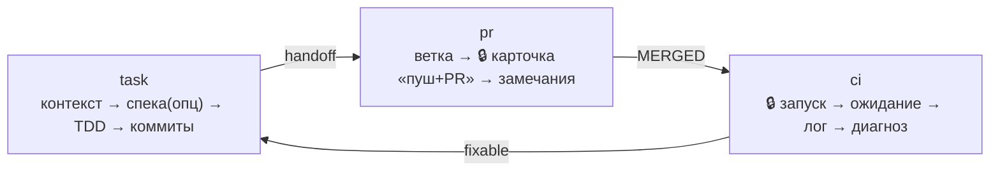

# ship-kit — базовый комплект

Три скилла-фазы: `task` (разработка), `pr` (доставка), `ci`
(сборка/деплой). Работают без какой-либо конфигурации проекта.



## Вызовы

```
/ship-kit:task PRJ-42 добавь экспорт CSV, mcp-jira=jira-corp, mcp-confluence=wiki, mcp-mmap=maps
/ship-kit:pr отправь на ревью, mcp-bitbucket=bb
/ship-kit:ci запусти сборку export-build, mcp-build=jenkins-corp
```

MCP-алиасы передаются аргументами вызова и сверяются с
`settings.json → mcpServers` проекта; чего не передали — того в проекте
нет (или спросит человека).

## Как это работает

1. **Фаза целиком за один вызов**: один Шаг-0 (проверка MCP, сборка
   порядка прогона) — основная работа — один контракт отчёта с
   дословными доказательствами. Следующая фаза — handoff-строкой.
2. **Гейты 🔒 — три правила**: карточка-превью → явное «да» → действие;
   отказ = стоп; «подтверждаю …» в задании = pre-approved. Пуш+PR —
   одной карточкой; каждый запуск джобы — своей.
3. **Внешние скиллы и порядок**: задание перечисляет скиллы — `task`
   собирает чек-лист (перечисление + слоты фаз) и подтверждает его один
   раз; гейт PR стоит на строке слота `pr`. Типовые наборы — макросом
   `ship-kit.workflows.md` (опционально, формат — именованные md-списки).
4. **Спецификация** — скиллом спекирования проекта, найденным в
   рантайме (по description); нет — мини-дизайн в чате. Конвенция
   проекта сильнее умолчаний: обязывает спеку и называет инструмент;
   аргументы вызова — лесенкой задание > конвенция проекта > вопрос.
5. **Падение CI**: `ci` разбирает лог по kind-файлу (build/deploy),
   даёт категорию/fixable/связанность; связанный фикс — в тот же PR,
   посторонний — тех-ветка от базовой и отдельный PR (артефакты спеки
   не трогаются), не-код — `issues.md` + эскалация человеку.
6. **Состояние** — `skill-runs/<КЛЮЧ>/plan.md` (чек-лист, журнал;
   создаётся всегда: без внешних скиллов — дефолт task → pr → ci) и
   `issues.md`; фазы идут по плану без остановки (паузы — только
   гейты и вопросы), «продолжи PRJ-42» — скилл читает план и
   продолжает.

## Границы

- Пуш — только в рабочие ветки `<X>/<КЛЮЧ>`; целевые ветки запрещены.
- Статусы задач трекера не меняются; «ничего не искать».
- Правки репозитория — только через PR.

## Чек-лист адаптации под проект

1. MCP-серверы проекта в `settings.json → mcpServers`; CI даёт контракт
   «запуск/статус/лог».
2. Push-политика: рабочие ветки разрешены, целевые запрещены.
3. `.gitignore` проекта: `skill-runs/`.
4. `permissions.allow` в settings проекта для MCP-инструментов и
   рабочих команд (git/openspec/node) — иначе терминал будет спрашивать
   разрешение на каждом шаге.
5. (Опционально) макрос `ship-kit.workflows.md` с типовыми наборами
   скиллов проекта.
6. Сложные случаи (многостадийный конвейер с лимитами) — образец
   `examples/conveyor/` в корне репо.
