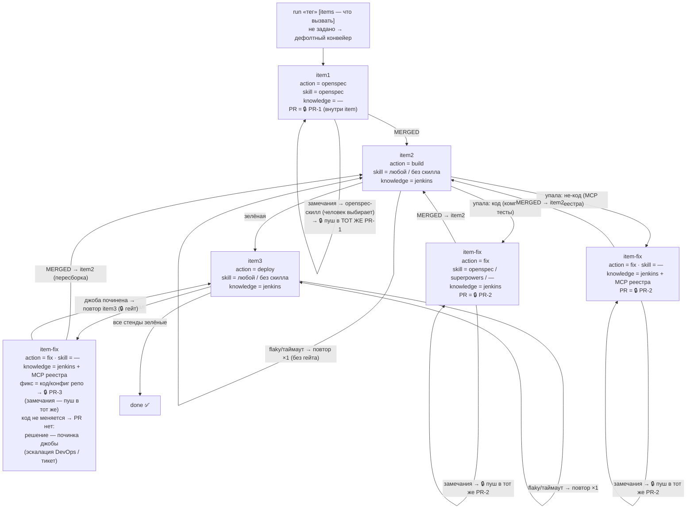
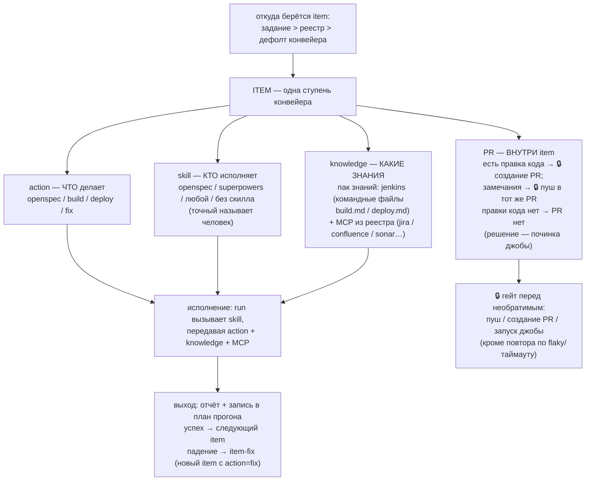

# Эталон: скиллы ship-kit

Комплект из **9 скиллов** и испытательного стенда для конвейера
«Jira → OpenSpec → правки → PR → ревью → сборка → деплой → исправление».

Репозиторий сам является **расширением Qwen Code `ship-kit`** (манифест
`qwen-extension.json` в корне, ресурсы в `skills/`, `mcp/`, `e2e/`).
Установка — `qwen extensions install <git-url этого репо>` (для разработки —
`qwen extensions link <путь>`); скиллы доступны как `/ship-kit:<имя>`.
Обязательные правила любой доработки — скилл
[skills/adapt-kit/SKILL.md](../skills/adapt-kit/SKILL.md).

Основа: Qwen Code 0.24.6. Архитектура конвейера — items-модель
(решение 2026-11-11 по исследованию; материалы разработки — в
репозитории проекта, `dev/`).

## 1. Состав (эталон расширения)

Корень расширения — **эталон**: устанавливается целиком, содержит только
поставляемое.

```
qwen-extension.json      манифест расширения ship-kit (name, version)
QWEN.md                  контекст расширения (шпаргалка)
skills/                  9 скиллов контура
  run/                   диспетчер items-конвейера («<тег> [items] <что сделать>»)
  jobs/                  запуск/ожидание джоб (kind=build|deploy, гейт запуска)
  diagnosis/             разбор падения + build.md, deploy.md (knowledge-пак)
  repair/                не-кодовый фикс по диагнозу + build.md, deploy.md
  openspec/              контекст (Jira/Confluence/mmap) и изменение OpenSpec
  pr/                    обвязка: ветка, PR (внутри item), цикл замечаний
  review/                ревью диффа, только чтение (ручной инструмент)
  registry/              ведение ship-kit.projects.md
  adapt-kit/             правила доработки комплекта
docs/
  ship-kit.md            этот документ
  ship-kit.projects.example.md   схема md-реестра
```

Воркспейс разработки (тот же git-репозиторий, вне корня расширения — в
установку не попадает): `dev/<имя-расширения>/` — для ship-kit это
`dev/ship-kit/`: транскрипт-источник требований (`about-my-work.md`), план
архитектуры тестов, `plans/` и `research/` (планы задач и исследования),
`e2e/` (моки MCP стенда `e2e/mcp/`, таргет с багом `e2e/target/`,
bare+клон — gitignore), `tests/` (скрипты уровней 1–2). Обновление
установленной копии эталона — `dev/sync-reference.sh [имя]` (конвенция
`dev/<имя>/` — по каталогу на расширение).

Сборку и деплой обслуживают **разные команды** — знания о них разнесены
по командным файлам `diagnosis/build.md|deploy.md` и
`repair/build.md|deploy.md` (**knowledge-пак**, дефолт `jenkins`); при
вызове читается только файл своего kind.

## 2. Девять скиллов

| Скилл | Что делает | MCP (alias из аргументов) |
|---|---|---|
| `run` | Диспетчер items-конвейера: «тег [items/скилл] задание», дефолт openspec→build→deploy, план `skill-runs/<тег>/`, гейты/стенды/retry-lazy в плане, стоп по отказу гейта | читает md-реестр; ролям передаёт их alias |
| `jobs` | Режим «запуск» — 🔒 гейт с карточкой, один вызов, без ретраев; режим «ожидание» — статус/лог/eta/possiblyStuck | mcp-build, mcp-deploy |
| `diagnosis` | Диагноз падения: категория/fixable/fixHint/knownIssues/confidence; командный файл по kind (knowledge-пак) | mcp-build/mcp-deploy (лог) + mcp-jira, mcp-confluence, mcp-sonar, mcp-bitbucket |
| `repair` | Не-кодовый фикс по диагнозу, TDD (красный → правка → зелёный), коммит, 🔒 гейт пуша, push в рабочую ветку PR | mcp-build/mcp-deploy (сверка лога) |
| `openspec` | Контекст конвейера и оформление изменения `openspec/changes/<КЛЮЧ>-<slug>/` | mcp-jira, mcp-confluence, mcp-mmap |
| `pr` | Обвязка контура: ветка `<X>/<КЛЮЧ>`, коммиты, 🔒 гейт «пуш+PR», PR — часть item; замечания: фикс openspec-скиллом (выбирает человек) → 🔒 пуш в тот же PR | mcp-jira, mcp-bitbucket |
| `review` | Ревью диффа/ветки, вердикт+находки с файл:строка (в `run`-цепочку не входит) | — |
| `registry` | Единственная точка ведения `ship-kit.projects.md` | — |
| `adapt-kit` | Правила доработки комплекта (точки адаптации, инварианты, критерии) | — |

## 3. Инварианты (кратко; полный список — adapt-kit)

Один скилл = одна область знания; один вызов = один шаг. Конвейер — items:
`item(action, skill, knowledge, PR)`, PR — часть item. Только MCP из
аргументов вызова; файл проектов роли не читают; ничего не искать.
Командные файлы kind обязательны и взаимоисключающие (knowledge-пак).
Формат отчёта — контракт (человек и `run`). Без описания контекста
исполнения. Явный вызов не тянет цепочку — её ведёт только `run`. Push —
только в рабочие ветки, целевые ветки запрещены; статусы Jira не трогать.
Шаг 0 обязателен. **Гейты необратимых действий**: запуск джобы, пуш,
создание PR — только после явного подтверждения человека; повтор по
flaky/таймауту наследует гейт; отказ = стоп.

## 4. Реестр проектов (md)

`ship-kit.projects.md` в корне проекта или `~/.qwen/ship-kit/projects.md`;
схема и пример — [ship-kit.projects.example.md](ship-kit.projects.example.md):
jira-ключ, ssh-репо, КЭ (конфигурационный элемент — идентификатор для
обращений по МСП, например МСП результатов проверок уязвимостей), alias →
фактический сервер (+ опционально `<alias>.tool.run|.status|.log` — точные
имена инструментов, `<alias>.model` — модель транспорта запуска:
`jenkins` (дефолт, путь+имя джобы) | `custom` (карта `launch.params`);
валидация по модели — `registry` и уровень 2), пути и точные названия джоб
(в т.ч. `mcp-deploy.job.name.<СТЕНД>`), `deploy.stands` (DEV, ST, IFT,
PSI — канонический порядок, IFT/PSI обязательны), `knowledge` (пак знаний,
дефолт `jenkins`), лимиты (`runLimit.*` — деплой на стенд, `retryLimit`,
`fixRetries`, `runBudget`), политики ошибок. Ведение — только скилл
`registry`. Отсутствие alias-записи = «в проекте этого MCP нет».

## 5. Аргументы запуска джоб: цепочка разрешения и запрет поиска

Порядок разрешения аргументов запуска (скилл `run`): **args → реестр
(имя/путь джобы, стенд) → предыдущая успешная джоба (параметры; типично
~50 параметров, меняется один — номер сборки) → вопрос пользователю →
дефолты только по явному слову пользователя**. Каждый разрешённый аргумент
и ответ пользователя фиксируются в разделе «Аргументы джоб» плана прогона —
возобновлённый прогон не переспрашивает. Из истории той же успешной джобы
берётся её длительность и передаётся `jobs` (режим ожидания) аргументом
«ожидаемая длительность» (роль отвечает eta и флагом possiblyStuck при ~2×
ожидаемого). Жёсткое ограничение для всех скиллов и `run`: **ничего не
искать** — не перечислять джобы, не сканировать сервер, не угадывать пути;
источники — реестр, args, история прошлой успешной джобы и ответ
пользователя.

## 6. Items-конвейер: схемы и правила

Конвейер = последовательность **item**; каждый item =
`item(action, skill, knowledge, PR)`, слоты независимы; источник items:
задание > реестр > дефолт `item1(openspec) → item2(build) → item3(deploy)`.

### Схема конвейера (дефолт)



### Анатомия item



### Правила

1. **Гейты 🔒** — запуск джобы (каждый, включая каждый стенд), любой пуш,
   создание PR: подтверждение только явными словами человека (ответ на
   вопрос с карточкой или дословное «подтверждаю …» в задании); отказ =
   STOPPED «гейт отклонён».
2. **Таймауты и flaky не переспрашивают**: тот же запуск после таймаута
   вызова или падения с категорией таймаута/flaky → один повтор без фикса
   и без нового гейта (`retryLimit`, дефолт 1); стабильное падение →
   item-fix.
3. **Замечания любого PR** правятся пушем в тот же PR; новый PR — только на
   новый фикс после упавшей сборки/деплоя.
4. **Код-фиксы** (компиляция/тесты/замечания) — openspec-скилл; точный
   скилл называет человек (пауза-вопрос или задание). Между item1 и
   «пушем+PR» других скиллов нет.
5. **Не-кодовые падения** — диагноз по MCP из реестра + knowledge-пак;
   фикс кода/конфига → PR. У деплоя может отсутствовать исправление кода —
   тогда PR нет вообще: решение в починке самой джобы (эскалация
   DevOps/тикет), затем повтор деплоя (🔒 гейт). Прямого пуша без PR нет.
6. **Стенды** (item3): `deploy.stands`, каждый стенд — свой запуск (гейт);
   `runLimit.deploy` — на стенд; `runBudget` — общий, заморожен в ожидании
   (гейт/апрув/починка джобы).
7. **Целевые ветки запрещены**: пуш только в рабочую ветку `<X>/<КЛЮЧ>`
   прогона; `branchDefault`/база PR — никогда.

## 7. Диспетчер-режим `run` и взаимодействие скиллов

- Вход — «`<тег> [items | скилл] <что сделать>`»: задание может называть
  конкретный item или скилл; не задано — дефолтный конвейер. Тег матчится
  с `jiraKey` реестра. «продолжи прогон <тег>» — resume по плану.
- **Явный вызов одного скилла не запускает следующие**: попросили `jobs`
  (ожидание) — никакого автоматного `diagnosis`/`repair`. «Соседние шаги»
  в хвосте скилла — навигация для человека.
- **Референс — Superpowers** (obra/superpowers): методика план-файлов,
  скилл-чек до действия. Отличие: здесь автоматический переход запрещён —
  только человек или `run`.
- **Разделение труда с OpenSpec**: спека и реализация tasks.md — скиллы
  OpenSpec (openspec-*), когда установлены; `openspec` собирает контекст
  и оформляет изменение; `pr` — обвязка контура; фикс замечаний PR и
  код-фиксы — openspec-скилл по выбору человека.

## 8. История выполнения скиллов — `skill-runs/` в корне проекта

План + статусы в духе план-файлов Superpowers/OpenSpec:

```
skill-runs/<тег>/
  plan.md     состояние (фаза/item, счётчики попыток и retry, PR, стенды,
              «чего ждём», бюджет) + items + раздел «Аргументы джоб»
              (значение и источник каждого) + «Гейты» (действие, результат,
              источник) + журнал событий
  issues.md   отдельные задачи с ошибками: номер, шаг, дословная ошибка,
              каким скиллом чинить, статус open/fixed/wontfix
```

Провалившийся шаг не пропускается молча — становится задачей в issues.md,
чинит другой скилл. В `.gitignore` целевого проекта (runtime-состояние).

## 9. Испытательный стенд (e2e)

Стенд живёт в воркспейсе разработки (`dev/ship-kit/e2e/` репозитория), в
установку не попадает. Моки — `dev/ship-kit/e2e/mcp/`, подключены
`.qwen/settings.json` корня репо под id `jenkins`, `jira`, `confluence`,
`sonar`, `bitbucket`, `mmap`; **md-реестр стенда отображает alias на эти
id** — проверяется alias-механика, а не имена (мок `jenkins` — просто
стенд с контрактом запуск/статус/лог). Ключевые решения:

- **Файловое состояние моков** (`.qwen/tmp/*-mock-state.json`): у каждого
  вызова свой stdio-процесс MCP. Сброс перед прогоном:
  `rm -f .qwen/tmp/*-mock-state.json`.
- **Детерминизм**: первый запуск сборки/деплоя → FAILURE (фикстура лога),
  далее SUCCESS; первый опрос статуса → RUNNING, далее терминальный.
- **Таргет с багом**: `dev/ship-kit/e2e/target/app.py:19` — `def div(a, b)`
  без двоеточия; воспроизводится импортом, чинится правкой в один символ.
- **Изоляция**: bare-репозиторий + клон (`dev/ship-kit/e2e/bare.git`,
  `dev/ship-kit/e2e/e2e-run`, gitignore) — пуши уходят в bare.

Сценарии прогонов и порядок внедрения — план архитектуры тестов в
`dev/ship-kit/` воркспейса разработки (прогоны — только на
`glm-5.3-flash`).

## 10. Чек-лист адаптации под целевой проект

1. **MCP-серверы**: id проекта в `settings.json → mcpServers` — какие id
   скрываются за alias, определяет реестр (п. 4), скиллы править не нужно.
   CI-сервер должен давать контракт «запуск/статус/лог» (adapt-kit §3).
2. **Реестр**: заведите `ship-kit.projects.md` скиллом `registry` —
   jiraKey, repoSsh, КЭ, alias→сервер (+ `tool.*` при необходимости),
   пути/названия джоб, `deploy.stands`, `knowledge`, лимиты.
3. **OpenSpec**: скиллы openspec-* установлены и CLI доступен.
4. **Push-политика**: рабочие ветки разрешены, целевые запрещены; статусы
   Jira переводит человек.
5. **.gitignore целевого проекта**: `skill-runs/`.

## 11. Границы решения

- `review` не запускает код и не входит в цепочку `run` — только чтение по
  явному вызову; проверка исполнением остаётся за сборкой и TDD-шагом
  фикса.
- Гейты и ожидания (апрув PR, починка джобы) — паузы прогона с фиксацией в
  плане, не webhook; бюджет в ожидании заморожен.
- Никто в цепочке не пишет комментарии/статусы в Jira — только чтение;
  расширение — отдельное явное решение.
- Скиллы не знают бренда CI: CI-специфика — в knowledge-паке
  (командные файлы), транспорт — контракт трёх операций.
