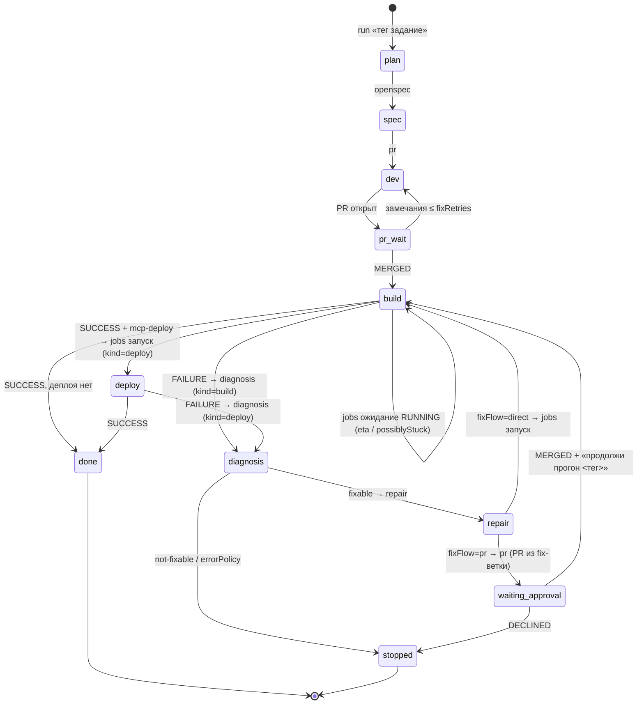

# Эталон: скиллы ship-kit

Комплект из **9 скиллов** и испытательного стенда для конвейера
«Jira → OpenSpec → правки → PR → ревью → сборка → деплой → исправление».

Репозиторий сам является **расширением Qwen Code `ship-kit`** (манифест
`qwen-extension.json` в корне, ресурсы в `skills/`, `mcp/`, `e2e/`).
Установка — `qwen extensions install <git-url этого репо>` (для разработки —
`qwen extensions link <путь>`); скиллы доступны как `/ship-kit:<имя>`.
Обязательные правила любой доработки — скилл
[skills/adapt-kit/SKILL.md](../skills/adapt-kit/SKILL.md).

Основа: Qwen Code 0.24.6.

## 1. Состав

```
qwen-extension.json      манифест расширения ship-kit (name, version)
QWEN.md                  контекст расширения (шпаргалка)
skills/                  9 скиллов контура
  run/                   диспетчер и прогон («<тег> <что сделать>»)
  jobs/                  запуск/ожидание джоб (kind=build|deploy)
  diagnosis/             разбор падения + build.md, deploy.md
  repair/                исправление по диагнозу + build.md, deploy.md
  openspec/              контекст (Jira/Confluence/mmap) и изменение OpenSpec
  pr/                    ветка, PR, цикл замечаний (обвязка контура)
  review/                ревью диффа, только чтение
  registry/              ведение ship-kit.projects.md
  adapt-kit/             правила доработки комплекта
docs/
  ship-kit.md            этот документ
  ship-kit.projects.example.md   схема md-реестра
  tests-architecture.md  архитектура тестов (план)
mcp/                     6 stdio-моков + фикстуры логов (e2e-стенд)
e2e/
  target/                таргет с инжектированным багом (app.py:19)
  e2e-runs.md            журнал e2e-прогонов (создаётся при прогонах)
  bare.git/, e2e-run/    изолированный прогон (gitignore)
.qwen/settings.json      MCP-моки стенда
```

Сборку и деплой обслуживают **разные команды** — знания о них разнесены
по командным файлам `diagnosis/build.md|deploy.md` и
`repair/build.md|deploy.md`; при вызове читается только файл своего kind.

## 2. Девять скиллов

| Скилл | Что делает | MCP (alias из аргументов) |
|---|---|---|
| `run` | Диспетчер: разбирает «тег задание», выбирает ступени, ведёт план `skill-runs/<тег>/`, циклы до успеха, fixFlow, ожидание апрува, лимиты/бюджет | читает md-реестр; ролям передаёт их alias |
| `jobs` | Режим «запуск» — один вызов, без ретраев; режим «ожидание» — статус/лог/eta/possiblyStuck | mcp-build, mcp-deploy |
| `diagnosis` | Диагноз падения: категория/fixable/fixHint/knownIssues/confidence; командный файл по kind | mcp-build/mcp-deploy (лог) + mcp-jira, mcp-confluence, mcp-sonar, mcp-bitbucket |
| `repair` | Минимальная правка по диагнозу, TDD (красный → правка → зелёный), коммит, push в рабочую ветку; командный файл по kind | mcp-build/mcp-deploy (сверка лога) |
| `openspec` | Контекст конвейера и оформление изменения `openspec/changes/<КЛЮЧ>-<slug>/` | mcp-jira, mcp-confluence, mcp-mmap |
| `pr` | Обвязка контура: ветка `<X>/<КЛЮЧ>` (дефолты feature/bugfix по типу задачи; шаблон — задание/реестр), коммиты с ключом Jira, PR, check/fix замечания; реализацию tasks.md делегирует скиллу OpenSpec | mcp-jira, mcp-bitbucket |
| `review` | Ревью диффа/ветки, вердикт+находки с файл:строка | — |
| `registry` | Единственная точка ведения `ship-kit.projects.md` | — |
| `adapt-kit` | Правила доработки комплекта (точки адаптации, инварианты, критерии) | — |

## 3. Инварианты (кратко; полный список — adapt-kit)

Один скилл = одна область знания; один вызов = один шаг. Только MCP из
аргументов вызова; файл проектов роли не читают; ничего не искать.
Командные файлы kind обязательны и взаимоисключающие. Формат отчёта —
контракт (человек и `run`). Без описания контекста исполнения. Явный вызов
не тянет цепочку — её ведёт только `run`. Push только в рабочие ветки;
статусы Jira не трогать. Шаг 0 обязателен.

## 4. Реестр проектов (md)

`ship-kit.projects.md` в корне проекта или `~/.qwen/ship-kit/projects.md`;
схема и пример — [ship-kit.projects.example.md](ship-kit.projects.example.md):
jira-ключ, ssh-репо, КЭ (конфигурационный элемент — идентификатор для
обращений по МСП, например МСП результатов проверок уязвимостей), alias →
фактический сервер, пути и точные названия джоб, `fixFlow`, лимиты
(`runLimit.*`, `fixRetries`, `runBudget`), политики ошибок. Ведение — только
скилл `registry`. Отсутствие alias-записи = «в проекте этого MCP нет».

## 5. Аргументы запуска джоб: цепочка разрешения и запрет поиска

Порядок разрешения аргументов запуска (скилл `run`): **args → реестр
(имя/путь джобы) → предыдущая успешная джоба (параметры; типично ~50
параметров, меняется один — номер сборки) → вопрос пользователю → дефолты
только по явному слову пользователя**. Каждый разрешённый аргумент и ответ
пользователя фиксируются в разделе «Аргументы джоб» плана прогона —
возобновлённый прогон не переспрашивает. Из истории той же успешной джобы
берётся её длительность и передаётся `jobs` (режим ожидания) аргументом
«ожидаемая длительность» (роль отвечает eta и флагом possiblyStuck при ~2×
ожидаемого). Жёсткое ограничение для всех скиллов и `run`: **ничего не
искать** — не перечислять джобы, не сканировать сервер, не угадывать пути;
источники — реестр, args, история прошлой успешной джобы и ответ
пользователя.

## 6. Циклы «до успеха» и ожидание апрува

Сборка/деплой идут циклами до `runLimit.build`/`runLimit.deploy` (дефолты
3/2, args сильнее); круг правок по замечаниям ПР — `fixRetries` (дефолт 3).
Способ доставки фикса — `fixFlow` в реестре: `direct` (пуш ветки фикса →
пересборка) или `pr` (фикс → ПР → **waiting-approval**: прогон
останавливается, план фиксирует PR/попытку/«чего ждём»; после MERGED —
«продолжи прогон <тег>» возобновляет пересборку). Одна попытка = весь цикл
«фикс → (ПР + апрув) → пересборка». `runBudget` (минуты) — честная
остановка STOPPED_BUDGET по исчерпании. План прогона несёт
заголовок-состояние — это токен возобновления после обрыва.



`runBudget` исчерпан — переход в `stopped` возможен из любой фазы.

## 7. Диспетчер-режим `run` и взаимодействие скиллов

- Вход — «`<тег> <что сделать>`» (напр. «PRJ-123 запусти джобу и исправь
  ошибки»): `run` сам выбирает подмножество ступеней по таблице намёков
  («запусти» = jobs запуск→ожидание; «…и исправь» = +diagnosis/repair/
  пересборка; «полный прогон» = вся цепочка; «продолжи прогон <тег>» =
  resume по плану), тег матчится с `jiraKey` реестра. Механика — как во
  входном скилле Superpowers (using-superpowers): модель выбирает скиллы
  по описаниям, аргументы передаются дословно; платформенной «автоцепочки»
  нет — дисциплина выбора зашита в текст скилла.
- **Явный вызов одного скилла не запускает следующие**: попросили `jobs`
  (ожидание) — никакого автоматного `diagnosis`/`repair`. «Соседние шаги»
  в хвосте скилла — навигация для человека.
- **Референс — Superpowers** (obra/superpowers): методика план-файлов,
  скилл-чек до действия, явные ссылки на смежные скиллы. Пакет не входит
  в комплект; заимствована методика. Отличие: у Superpowers process-скиллы
  ссылаются друг на друга как «REQUIRED SUB-SKILL», здесь автоматический
  переход запрещён — только человек или `run`.
- **Разделение труда с OpenSpec**: документация изменения и реализация
  tasks.md — скиллы OpenSpec (openspec-*), когда установлены. `openspec`
  собирает контекст конвейера и оформляет изменение; `pr` — обвязка
  контура (ветка, коммиты, PR, замечания).

## 8. История выполнения скиллов — `skill-runs/` в корне проекта

Не журнал фактов, а **план + статусы** в духе план-файлов
Superpowers/OpenSpec:

```
skill-runs/<тег>/
  plan.md     заголовок-состояние (фаза, счётчики попыток, PR, последняя
              сборка, чего ждём, бюджет) + чек-лист выбранных ступеней +
              раздел «Аргументы джоб» (значения и источник каждого) +
              журнал событий
  issues.md   отдельные задачи с ошибками: номер, шаг, дословная ошибка,
              каким скиллом чинить, статус open/fixed/wontfix
```

Провалившийся шаг не пропускается молча — становится задачей в issues.md,
чинит другой скилл. В `.gitignore` целевого проекта (runtime-состояние).

## 9. Испытательный стенд (e2e)

Моки живут в `mcp/` и подключены `.qwen/settings.json` под id `jenkins`,
`jira`, `confluence`, `sonar`, `bitbucket`, `mmap`; **md-реестр стенда
отображает alias на эти id** — проверяется alias-механика, а не имена.
Ключевые решения:

- **Файловое состояние моков** (` .qwen/tmp/*-mock-state.json`): у каждого
  вызова свой stdio-процесс MCP, память не переживает вызовов. Сброс перед
  прогоном: `rm -f .qwen/tmp/*-mock-state.json`.
- **Детерминизм**: первый запуск сборки/деплоя → FAILURE (фикстура лога),
  далее SUCCESS; первый опрос статуса → RUNNING, далее терминальный.
- **Таргет с багом**: `e2e/target/app.py:19` — `def div(a, b)` без
  двоеточия; воспроизводится импортом, чинится правкой в один символ.
- **Изоляция**: bare-репозиторий + клон (`e2e/bare.git`, `e2e/e2e-run`,
  gitignore) — пуши уходят в bare.

Сценарии прогонов и порядок внедрения —
[tests-architecture.md](tests-architecture.md) (план; прогоны — только на
`glm-5.3-flash`).

## 10. Чек-лист адаптации под целевой проект

1. **MCP-серверы**: id проекта в `settings.json → mcpServers` — какие id
   скрываются за alias, определяет реестр (п. 4), скиллы править не нужно.
2. **Реестр**: заведите `ship-kit.projects.md` скиллом `registry` —
   jiraKey, repoSsh, КЭ, alias→сервер, пути/названия джоб, fixFlow,
   лимиты.
3. **OpenSpec**: скиллы openspec-* установлены и CLI доступен.
4. **Push-политика**: рабочие ветки разрешены; статусы Jira переводит
   человек.
5. **.gitignore целевого проекта**: `skill-runs/`.

## 11. Границы решения

- `review` не запускает код — только чтение; проверка исполнением
  остаётся за сборкой и TDD-шагом `repair`.
- Ожидание апрува — пауза прогона с фиксацией в плане, не webhook.
- Никто в цепочке не пишет комментарии/статусы в Jira — только чтение;
  расширение — отдельное явное решение.
