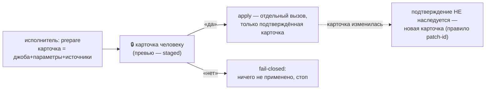
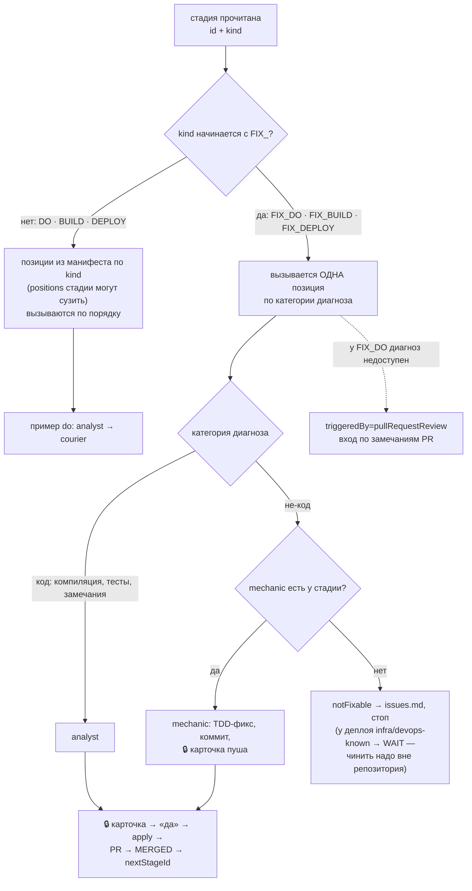
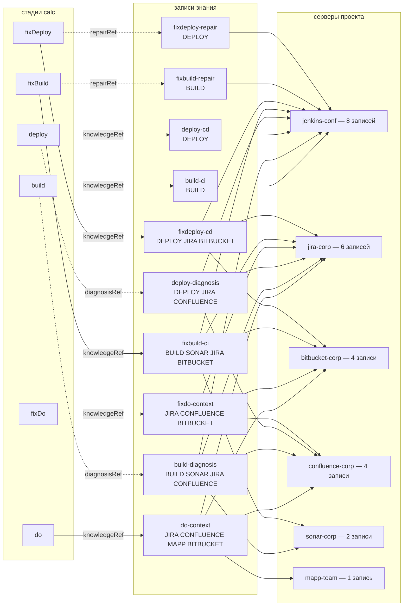
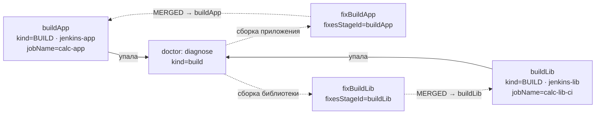

# Design: v2-stage-model

Источники: вложения сесси 13.11.2026 — модель `ship-kit.projects.yaml`
(«полная декомпозиция стадии», валидатор исследования: `ошибок: 0 ·
предупреждений: 8` на calc+billing; negtest ловит 6) и файл схем (mermaid
11.17.2, проверены). Эталон v1 — HEAD ветки v2. Решения пользователя
(13.11.2026, вечер): вариант Б (позиции + executors), имена «Профессии»,
объединение diagnosis+repair → doctor, миграции формата, yaml без md.

## 1. Контекст: чем v2 отличается от v1

| Аспект | v1 (items) | v2 (стадии) |
|---|---|---|
| Единица конвейера | `item(action, skill, knowledge, PR)`, дефолт item1–item3 | стадия с `id` из yaml; обход по `pipelineOrder` |
| Исполнители | имена скиллов в item | **позиции по kind (манифест) + `executors:` в проекте** |
| Транспорт знания | один набор `<alias>.*` на проект | запись знания **на стадию** (+ `diagnosisRef`/`repairRef` по потребителю) |
| Связь «падение → фикс» | префикс имени действия `fix-<действие>` | явное `fixesStageId` |
| Возврат после MERGED | выведен из префикса `fix-` | явное `nextStageId` |
| Счётчики/план | ключ — действие (`runLimit.build`) | ключ — **id стадии** |
| Вторая сборка в проекте | невозможна | `buildApp` + `buildLib`, свои фикс-стадии |
| PR | часть item, обвязка `pr` | то же + `pullRequestOwner` = позиция courier |
| Гейты | проза в скиллах | **контракт prepare → confirm → apply** (fail-closed, подтверждение по карточке) |
| Реестр | `ship-kit.projects.md` (плоские ключи) | `ship-kit.projects.yaml` (`formatVersion`, `servers:`, `executors:`) |

Не меняется: инварианты adapt-kit, шаг 0 исполнителей, форматы отчётов
исполнителей, гейты 🔒 (запуск джобы / пуш / PR — подтверждение человеком),
цепочка разрешения аргументов запуска (args → реестр → прошлая успешная
джоба → вопрос → дефолты только по слову пользователя), «ничего не искать»,
пуш только в рабочие ветки `<X>/<КЛЮЧ>`, статусы Jira не трогать,
knowledge-пак (командные файлы `build.md`/`deploy.md`, дефолт `jenkins`).

## 2. Структура модели

```mermaid
classDiagram
    class Registry {
        +String defaultProject
        +Integer formatVersion
        +Map servers
        +Map executors
        +List~Project~ projects
    }
    class Project {
        +String projectKey
        +String jiraProjectKey
        +String repoSshUrl
        +String artifactId
        +String defaultBranch
        +String description
        +List~String~ pipelineOrder
    }
    class BranchPrefix {
        +String task
        +String bug
    }
    class Limits {
        +Integer maxRuns
        +Integer maxRetries
        +Integer maxFixAttempts
        +Integer totalRunBudget
    }
    class ErrorPolicy {
        +List~String~ unfixableCategories
    }
    class Stage {
        +String id
        +List~String~ positions
        +String triggeredBy
        +String knowledgeRef
        +String diagnosisRef
        +String repairRef
        +String nextStageId
        +String fixesStageId
        +String pullRequestOwner
    }
    class StageKind {
        <<enumeration>>
        DO
        BUILD
        DEPLOY
        FIX_DO
        FIX_BUILD
        FIX_DEPLOY
    }
    class KnowledgeRecord {
        +String id
    }
    class Endpoint {
        +McpAlias alias
        +String serverId
        +RunnerKind runnerKind
        +String jobFolder
        +String jobName
        +List~String~ environments
        +Map environmentJobNames
        +String projectKey
    }
    class RunnerKind {
        <<enumeration>>
        JENKINS
        CUSTOM
    }
    class McpAlias {
        <<enumeration>>
        MCP_BUILD
        MCP_DEPLOY
        MCP_SONAR
        MCP_JIRA
        MCP_CONFLUENCE
        MCP_BITBUCKET
        MCP_MAPP
    }

    Registry "1" *-- "1..*" Project : projects
    Project "1" *-- "0..1" BranchPrefix : branchPrefix
    Project "1" *-- "0..1" Limits : limits
    Project "1" *-- "0..1" ErrorPolicy : errorPolicy
    Project "1" *-- "1..*" Stage : stages
    Project "1" *-- "1..*" KnowledgeRecord : knowledge
    Stage --> StageKind : kind
    Stage ..> Stage : nextStageId · fixesStageId
    Stage ..> KnowledgeRecord : knowledgeRef
    Stage ..> KnowledgeRecord : diagnosisRef (для doctor: diagnose)
    Stage ..> KnowledgeRecord : repairRef (для doctor: fix)
    KnowledgeRecord "1" *-- "1..*" Endpoint : endpoints
    Endpoint --> McpAlias : alias
    Endpoint --> RunnerKind : runnerKind
    note for Registry "servers: serverId → описание; executors: позиция → скилл (дефолты = комплект); адреса/токены только в settings.json"
    note for Stage "исполнители НЕ в стадии: набор позиций выводится из kind по манифесту; positions опционально сужает"
    note for KnowledgeRecord "Своя запись на стадию; у ступени транспорта их две — стадия и диагност"
```

## 3. Решения вопросов 1–6 черновика

### В1 — одна запись знания на стадию, а не на исполнителя → принять

Канон «запись обязана покрывать всех исполнителей СВОЕЙ стадии» сохраняется:
`do-context` содержит и `MCP_MAPP` (analyst), и `MCP_BITBUCKET` (courier).

### В2 — `fixesStageId` обязателен → принять

run ищет фикс-стадию по `fixesStageId = <id упавшей стадии>`. Свобода id
(две сборки: `buildApp`/`fixBuildApp`, `buildLib`/`fixBuildLib`).

### В3 — `pullRequestOwner` → принять; значение — позиция

Владелец PR стадии = позиция (по умолчанию `courier`) или null (build/deploy
— правок репозитория нет). Правила: замечания правятся пушем в **тот же**
PR; новый PR — только на новый фикс после упавшей джобы и только при реальной
правке. Правящий репозиторий исполнитель есть, а owner null → предупреждение
валидатора (случай billing).

### В4 — исходы после диагноза → правило по категории и доступной позиции

`doctor` в режиме `diagnose` даёт категорию; исходы:

- `flaky`/таймаут → retry без нового гейта (`maxRetries`, та же карточка);
- fixable → позиция по **таблице маршрутизации манифеста** (`fixRouting`:
  FIX_BUILD — «код» → analyst, «не-код» → mechanic; FIX_DEPLOY — любое
  fixable → mechanic, как в v1 `fix-deploy: repair`: правку репозитория
  деплоя ведёт один исполнитель). Позиции нет у стадии (сужена `positions`)
  → notFixable → issues.md, стоп;
- not-fixable → issues.md, стоп; **исключение деплоя**: категории
  `infra`/`devops-known` (чинить нужно вне репозитория) → **WAIT** —
  прогон и бюджет заморожены, «продолжи прогон <тег>» после починки джобы;
- категория из `errorPolicy.unfixableCategories` → вето: issues.md, стоп,
  фикс-стадия не вызывается вовсе.

### В5 — секция `servers:` → принять

serverId → описание/назначение; адреса и токены — только в
`settings.json → mcpServers`.

### В6 — `diagnosisRef` / `repairRef` по потребителю → принять, дефолт = knowledgeRef

- `diagnosisRef` (только у BUILD/DEPLOY): транспортный alias стадии с теми же
  `jobFolder`/`jobName` (расхождение — ошибка); может добавлять
  sonar/jira/confluence — их читает `doctor: diagnose`;
- `repairRef` (только у FIX_BUILD/FIX_DEPLOY): ровно один транспортный alias;
  отличие джобы от `knowledgeRef` — замысел (упавшая вместо быстрой
  ci-джобы) — его читает `doctor: fix` для сверки первопричины.

## 4. Слой исполнителей: схема Б — позиции, executors, манифест

### 4.1 Манифест позиций (файл комплекта `docs/ship-kit.positions.yaml`)

Позиция — именованный слот с контрактом (заимствование — контракт extensions
spec-kit):

```yaml
version: 1
positions:
  analyst:            # спека + правки кода (бывш. openspec + код-фиксы)
    type: executor
    contract: {step0: проверить MCP, report: поля отчёта, gates: ask-таблица}
  courier:            # ветка, коммиты, PR, замечания (бывш. pr)
    type: executor
    contract: {...}
  operator:           # запуск/ожидание джоб (бывш. jobs)
    type: executor
    contract: {...}
  detective:          # диагноз падения — СЛУЖЕБНАЯ: вызывает run, не позиция стадии
    type: executor
    contract: {...}
  mechanic:           # не-код фикс по диагнозу (бывш. repair)
    type: executor
    contract: {...}
```

Контракт позиции = шаг 0 + формат отчёта + ask-правила (см. §6.4) + версия.
SKILL.md исполнителей пишутся **под** контракт манифеста. Trust-модель: комплект
исполнителей не ищет и не подбирает — только явная запись в проекте.

### 4.2 Дефолтные наборы позиций по kind (из манифеста)

| kind | позиции | примечание |
|---|---|---|
| DO | analyst, courier | PR-1 делает courier |
| BUILD | operator | |
| DEPLOY | operator | стенды, maxRuns на стенд |
| FIX_DO | analyst, courier | пуш в тот же PR-1; вход — `triggeredBy`: `pullRequestReview` (PR открыт) или `humanDirective` (PR уже MERGED — переделка по команде человека, правка **новым PR-2**) |
| FIX_BUILD | analyst, mechanic, courier | mechanic опциональна (`positions: [analyst]` отрежет не-код → notFixable) |
| FIX_DEPLOY | mechanic, courier | PR-3 только при реальной правке репозитория |

`positions` у стадии может только **сузить** дефолтный набор kind
(валидатор: подмножество). `detective` — не позиция стадии: её вызывает run
по падению BUILD/DEPLOY (doctor, режим diagnose). Соответствие «категория
диагноза → позиция» для фикс-стадий задаёт манифест (`fixRouting` по kind),
а не универсальное правило.

### 4.3 `executors:` в проекте — подмена исполнителя

```yaml
executors:              # всё дефолт — секцию можно не писать вовсе
  analyst:   ship-kit:analyst
  courier:   ship-kit:courier
  operator:  ship-kit:operator
  detective: ship-kit:doctor        # режим diagnose
  mechanic:  ship-kit:doctor        # режим fix
  # подмена в конкретном проекте — одной строкой, стадии не трогаем:
  # mechanic: superpowers:refactoring
```

Валидатор: позиция существует в манифесте; скилл заявлен явно (в executors
или дефолт комплекта); для внешних скиллов — предупреждение «контракт
проверяется e2e» (скилл — текст, машинно контракт не проверить; заимствование
Claude Code — честность про ask-правила).

## 5. Имена и объединение («Профессии», 8 → 7)

| v1 | v2 | почему |
|---|---|---|
| `openspec` | **analyst** | спека + контекст + правки кода по спеке; уходила коллизия с openspec-* скиллами |
| `pr` | **courier** | доставляет код: ветка, коммиты, PR, замечания |
| `jobs` | **operator** | запускает и наблюдает джобы |
| `diagnosis` + `repair` | **doctor** (режимы `diagnose` / `fix`) | всегда идут парой; диагноз не передаётся аргументом между скиллами; knowledge-пак build.md/deploy.md один |
| `run`, `registry`, `adapt-kit` | без изменений | имена точные |

Режим задаёт вызывающий (run или человек), doctor сам не переключает —
«один вызов = один шаг» (прецеденты: operator — запуск/ожидание; courier —
implement/check/fix). Режим `diagnose` — только чтение (наследник инварианта
«diagnosis не правит»); режим `fix` — TDD-фикс, 🔒 карточка пуша, push.

Словарь позиций (5 слов): analyst, courier, operator, detective, mechanic.
Позиция правки кода не отдельна — её закрывает analyst (бывш. rework).

Смена имён/словаря позже = уровень 2 (правка манифеста + `formatVersion++`
+ миграция реестров) — см. §12.

## 6. Заимствования (два круга ресёрча, сабагенты glm-5.3-flash, 13.11.2026)

| Источник | Берём | Куда ложится |
|---|---|---|
| github/gh-aw (safe-outputs) | prepare → confirm → apply; карточка = payload с превью; fail-closed | QWEN.md, run, plan.md |
| saadnvd1/agent-os | подтверждение привязано к payload (patch-id); loop guard | run, conveyor, plan.md |
| github/spec-kit (extensions) | манифест позиций: контракт + тип + версия; trust discovery-only | docs/ship-kit.positions.yaml, валидатор, adapt-kit |
| Claude Code (permissions) | таблица ask-правил на позицию | SKILL.md исполнителей |

Не берём: инфраструктуру gh-aw (git-bundle, GraphQL-push, Actions), очередь
задач agent-os, CLI spec-kit.

### 6.1 Гейт-контракт (gh-aw)

- **prepare**: исполнитель собирает карточку и НЕ применяет. Состав карточки:
  запуск джобы — kind, джоба (путь/имя), ветка, стенд, параметры **с
  источником каждого**; пуш — ветка, коммиты, суть правки; PR — ветка, база,
  описание.
- **confirm**: 🔒 карточка-превью человеку — ровно то, что будет применено.
- **apply**: отдельный вызов, только подтверждённая карточка, с минимальными
  правами (только переданные MCP).
- **fail-closed**: нет «да» = ничего не произошло; никаких молчаливых
  альтернатив; отказ → STOPPED.



### 6.2 Подтверждение по карточке и loop guard (agent-os)

- `pre-approved(источник)` и `inherited(причина)` действуют **только для
  идентичной карточки**: flaky-повтор тех же параметров наследует гейт;
  изменился хоть один параметр — новая карточка, новый вопрос.
- Loop guard: круг «фикс → PR → MERGED → перезапуск» = +1 к
  `maxFixAttempts`; новый PR счётчик не сбрасывает; исчерпан — стоп.

### 6.3 Манифест позиций (spec-kit)

Словарь позиций — не проза, а манифест с контрактом и версией (§4.1).
Валидатор сверяет `executors` и `positions` стадий с манифестом.

### 6.4 Ask-правила (Claude Code)

Таблица правил в начале SKILL.md каждой позиции:

| действие | правило |
|---|---|
| запуск джобы (каждый, вкл. каждый стенд) | ask · всегда |
| пуш | ask · всегда |
| создание PR | ask · всегда |
| flaky-повтор | inherited — только идентичная карточка |
| чтение (статус/лог/поиск тикетов) | allow |
| всё сверх переданных MCP | deny |

## 7. Конвейер проекта `calc` (семантика run)

Сплошное — обход (`pipelineOrder`), пунктир — возврат после MERGED
(`nextStageId`), штрих-пунктир — входы в фикс-стадию.

```mermaid
flowchart TB
    subgraph PIPE["pipelineOrder: do → build → deploy"]
        direction LR
        DO["do<br/>kind=DO<br/>analyst → courier · PR-1"]
        BUILD["build<br/>kind=BUILD<br/>operator · maxRuns=3"]
        DEPLOY["deploy<br/>kind=DEPLOY<br/>operator · maxRuns=2 на стенд"]
        DO -->|🔒 PR-1| BUILD
        BUILD -->|зелёная| DEPLOY
    end
    DONE["все стенды зелёные ✅"]
    FIXDO["fixDo<br/>FIX_DO · analyst + courier<br/>замечания — в тот же PR-1"]
    FIXBUILD["fixBuild<br/>FIX_BUILD · код: analyst ·<br/>не-код: mechanic · PR-2"]
    FIXDEP["fixDeploy<br/>FIX_DEPLOY · mechanic · PR-3<br/>при реальной правке репо"]
    DIAGB["doctor: diagnose<br/>kind=build"]
    DIAGD["doctor: diagnose<br/>kind=deploy"]
    ISSUE["issues.md · прогон стоит"]
    WAIT["починка джобы DevOps<br/>прогон ждёт"]
    DEPLOY -->|стенды зелёные| DONE
    DO -.->|замечания PR · triggeredBy| FIXDO
    FIXDO -.->|MERGED → do| DO
    BUILD -.->|упала| DIAGB
    DIAGB -.->|fixable: код→analyst · не-код→mechanic| FIXBUILD
    FIXBUILD -.->|MERGED → пересборка| BUILD
    DEPLOY -.->|упал на стенде| DIAGD
    DIAGD -.->|fixable: правка репо → PR-3| FIXDEP
    FIXDEP -.->|MERGED → сначала build| BUILD
    DIAGD -.->|not-fixable: infra/devops-known| WAIT
    WAIT -.->|«продолжи прогон»| DEPLOY
    DIAGB -.->|notFixable| ISSUE
    DIAGD -.->|notFixable (прочее)| ISSUE
    FIXDO -.->|DECLINED · кругов > maxFixAttempts| ISSUE
```

«doctor: diagnose» — не стадия и не исполнитель: его вызывает run перед
выбором фикс-стадии, MCP — из `diagnosisRef` стадии. У do/fixDo своей джобы
нет — их падение идёт сразу в issues.md, без диагноза. Retry flaky/таймаута
(без нового гейта) на схеме не показан.

## 8. Чтение стадии: `kind` определяет позиции



Производный kind для ролей: BUILD/FIX_BUILD → build, DEPLOY/FIX_DEPLOY →
deploy (командные файлы knowledge-пака); DO/FIX_DO без джоб — operator и
doctor для них не вызываются.

## 9. Три потребителя записи знания



| потребитель | ссылка | что читает | почему не хватает записи стадии |
|---|---|---|---|
| исполнители стадии | `knowledgeRef` | свой MCP | — |
| `doctor: diagnose` | `diagnosisRef` | лог + тикеты команды + runbook | у стадии нет `MCP_CONFLUENCE` |
| `doctor: fix` | `repairRef` | лог **упавшей** джобы | запись фикс-стадии смотрит на быструю `calc-app-ci`, а сверять нужно по логу `calc-app` |

## 10. Две сборки; проект без деплоя



План прогона и счётчики ключуются id стадии: `Stage: buildApp → operator`,
`Попытка: 2/3` — независимо от `buildLib`.

Проект `billing`: `pipelineOrder: [do, build]`, стадий DEPLOY/FIX_DEPLOY нет,
ни одна запись знания не объявляет `MCP_DEPLOY` — ступень деплоя не
планируется. У стадии do `positions: [analyst]` (без courier — PR вне
стадии не оформляется, предупреждение валидатора про правящего исполнителя
без `pullRequestOwner`). Отсутствие `MCP_MAPP` — analyst работает без него и
не запрашивает.

## 11. Правила валидации реестра (registry + уровень 2)

1. Ссылки `knowledgeRef`/`diagnosisRef`/`repairRef`/`nextStageId`/
   `fixesStageId` существуют; id стадий и записей уникальны в проекте.
2. `diagnosisRef` — только у BUILD/DEPLOY; `repairRef` — только у
   FIX_BUILD/FIX_DEPLOY; дефолт = `knowledgeRef`.
3. `diagnosisRef` содержит транспортный alias стадии с теми же
   `jobFolder`/`jobName` (и `environments` для деплоя); расхождение — ошибка.
4. `repairRef` — ровно один транспортный alias; сверхтранспортные —
   предупреждение; отличие джобы от `knowledgeRef` — допустимо (замысел).
5. Запись покрывает всех исполнителей своей стадии (таблица позиций × alias).
6. `runnerKind: JENKINS` → `jobFolder`+`jobName`; `CUSTOM` → `jobParameters`,
   `jobFolder`/`jobName` запрещены.
7. `environments` — непустой список из DEV, ST, IFT, PSI в каноническом
   порядке; `environmentJobNames` — только при `environments`.
8. Фикс-стадия: обязательны `fixesStageId` и `nextStageId`; `triggeredBy` —
   только у FIX_DO.
9. `pipelineOrder`: элементы существуют и не FIX_*; не-фикс стадия вне
   `pipelineOrder` — предупреждение; дефолт `[do, build, deploy]` ∩
   существующие.
10. BUILD/DEPLOY стадии без фикс-стадии с `fixesStageId=<id>` —
    предупреждение (любое fixable-падение = notFixable).
11. `pullRequestOwner` — позиция (обычно courier) или null; правящий
    репозиторий исполнитель есть, а owner null — предупреждение.
12. `servers:`: неизвестный serverId — ошибка; неиспользуемый —
    предупреждение. Лимиты — целые ≥ 1; категории `errorPolicy` — из
    taxonomy.
13. `executors:`: позиция существует в манифесте; скилл заявлен явно;
    внешний скилл — предупреждение «контракт проверяется e2e».
14. `positions` стадии — подмножество дефолтного набора kind из манифеста;
    FIX_* без позиции для категории — предупреждение.

## 12. Миграции формата реестра

- `formatVersion: N` (отсутствует = 1). Читатель знает максимум M: `N = M` —
  работаем; `N < M` — registry ведёт по цепочке миграций из комплекта (дифф →
  подтверждение → применение, идемпотентно, непонятные значения переносятся
  как есть); `N > M` — стоп «обновите комплект».
- md v1 = формат «0» → yaml «1»: заведение заново (решение пользователя).
- Смена словаря позиций/имён скиллов — уровень 2: правка манифеста +
  `formatVersion++` + миграция.
- Тест: сценарий «реестр M−1 мигрирует до M, прогоны зелёные».

## 13. План прогона v2 (`skill-runs/<тег>/plan.md`)

```markdown
# Прогон <тег> — <задание>

## Состояние
Фаза: <id стадии> | waiting(<гейт | апрув | починка джобы>) | done | stopped
Стадия: <id> · позиции: <список> | Попытка: <n/maxRuns> | Retry: <n/maxRetries>
Фикс-круг: <n/maxFixAttempts> | PR: <PR-N или —> | Деплой: <стенд i/n, попытка j/k>
Ждём: <чего ждём> | Бюджет: <осталось минут или —>

## Стадии (pipelineOrder)
- [ ] do — analyst, courier · PR-1
- [ ] build — operator · цикл до maxRuns (+ maxRetries)
- [ ] deploy — operator · стенды <список>, maxRuns на стенд

## Аргументы джоб
job: <имя> (источник: yaml@<стадия>.<запись>)
параметры: <карта> (источник: …)

## Гейты
- <действие> — confirmed(<карточка: краткое содержание>) |
  pre-approved(источник, карточка=…) | inherited(та же карточка) | declined

## Журнал
- <время> — событие
```

Гейт в плане фиксирует **карточку** (краткое содержание payload) —
наследование подтверждения возможно только к идентичной карточке (§6.2).

## План перехода

1. Скиллы и docs v2 пишутся в чистое дерево ветки v2 (`extensions/ship-kit/`),
   коммит; старые файлы не переносятся — пишутся заново.
2. dev-воркспейс: валидатор yaml (правила §11 + executors↔манифест +
   миграции) и e2e-стенд под стадии; прогоны — только glm-5.3-flash.
3. `qwen-extension.json` → 1.0.0; синхронизация установленной копии
   `~/.qwen/extensions/ship-kit`.
4. Реестры целевых проектов заводятся заново скиллом `registry`.
5. Откат: v1 остаётся в истории git — checkout прежнего коммита и
   переустановка копии расширения.

## Риски и границы

- **run — наибольший объём правок** — закрывается e2e-стендом (сценарии v1 +
  стадийные: две сборки, WAIT-режим, вето errorPolicy, fixDo по замечаниям,
  подмена исполнителя в executors, наследование подтверждения по карточке).
- **Внешний исполнитель позиции** — контракт машинно не проверить (скилл =
  текст): валидатор даёт предупреждение, гарантию даёт только e2e-прогон.
- **Без миграции md → yaml** — реестры заводятся заново.
- **Схемы** перенесены из исследования (mermaid 11.17.2) с правками под
  профессии; рендер-скрипты исследования недоступны — при правках проверять
  парсером/визуально.
- Числа ресёрча (звёзды/даты) — из прогонов на glm-5.3-flash, не
  перепроверялись; на решения влияют только механики, не метрики.
