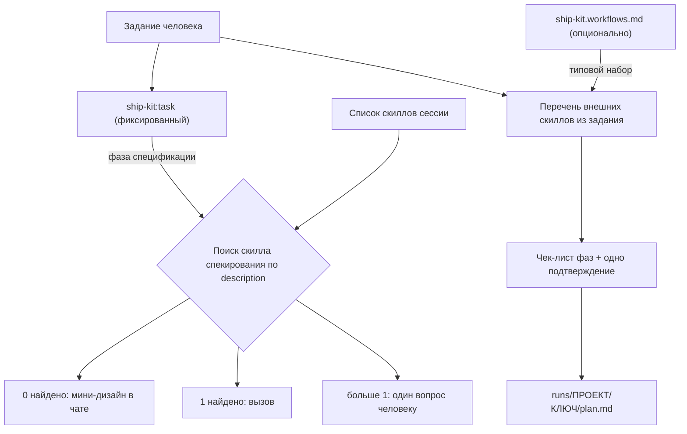
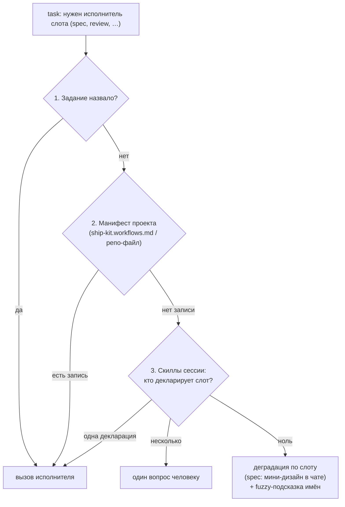

# Исследование: вызов переменного набора скиллов из фиксированного комплекта

Дата: 2026-11-20. Повод: задание пользователя — предложить новые лучшие
идеи, как один набор скиллов (ship-kit, фиксированный) вызывает другой
набор, меняющийся от проекта к проекту; готовые решения искать в
интернете, результат — в каталог исследований, переиспользовать после
подтверждения.

## Вопрос

Как известные системы решают задачу «фиксированный вызыватель →
переменный, зависящий от проекта, исполнитель»: где объявляется связь,
что происходит при отсутствии исполнителя, при нескольких кандидатах,
при несовместимой версии. Что из готового переиспользовать для ship-kit.

## Метод

Веб-чтение официальной документации; делегирование двум cheap-агентам
(glm-5.3-flash, скилл cheap-web-search), 13 систем, все страницы
прочитаны напрямую 2026-11-20.

## As-is: как ship-kit вызывает переменный набор сегодня

Два независимых пути: спека — рантайм-поиск по description; внешние
скиллы — перечень в задании (+ опциональный макрос). Конвенция проекта
может обязывать спеку и называть инструмент (лесенка задание >
конвенция > вопрос).

## Находки — готовые механизмы

| Механизм | Кто использует | Суть | Источник (прочитано 2026-11-20) |
|---|---|---|---|
| Декларация в самом исполнителе (точка расширения) | VS Code `contributes.*` + `activationEvents`; JetBrains `<extensions>` в plugin.xml; Zed `extension.toml` + `languages/*/config.toml`; pre-commit `.pre-commit-hooks.yaml`; Angular `collection.json` | исполнитель декларирует, что предоставляет; вызыватель сканирует установленных и матчит по id/имени точки; код запускается лениво по событию активации | code.visualstudio.com/api/references/contribution-points; plugins.jetbrains.com/docs/intellij/plugin-extensions.html; zed.dev/docs/extensions; pre-commit.com; angular.dev/tools/cli/schematics-authoring |
| Файл-манифест в проекте перечисляет исполнителей | pre-commit `.pre-commit-config.yaml` (`repo`+`rev`+`id`); Terraform `module { source, version }`; MCP `.mcp.json` → `mcpServers`; GitHub Actions `uses: owner/repo/.github/workflows/x.yml@ref` | связь живёт в проекте; пин версии обязателен или естественен (rev, @SHA); GHA: «If a release tag and a branch have the same name, the release tag takes precedence» | pre-commit.com; developer.hashicorp.com/terraform/language/modules/sources; code.claude.com/docs/en/mcp; docs.github.com/en/actions/using-workflows/reusing-workflows |
| Конвенция стабильного имени-слота | husky `.husky/<git-hook>` (исполняет сам git через `core.hooksPath`); just `justfile`; go-task `Taskfile.yml`; Claude Code: commit-инструкции запускают проектный скилл `verify`/`simplify`, если он есть | вызыватель знает только имя-слот; проект решает, что за ним; отсутствие — тихая деградация (husky) или статическая ошибка до запуска (just: «Unknown recipes and circular dependencies are reported before anything runs») | typicode.github.io/husky/; just.systems/man/en/; taskfile.dev; code.claude.com/docs/en/skills |
| Детерминированный каскад приоритетов | Qwen Code скиллы: «the first one found wins: project, then personal, then extension, then bundled»; Claude Code: «Enterprise over personal, and personal over project»; MCP: local > project > user, «fields are not merged across scopes»; `Taskfile.yml` > `Taskfile.dist.yml`; just `fallback` вверх по каталогам | несколько источников не конфликтуют: побеждает запись по таблице; расширения неймспейсятся (`ext:skill`) и сосуществуют | raw.githubusercontent.com/QwenLM/qwen-code (docs/users/features/skills.md); code.claude.com/docs/en/{skills,mcp}; taskfile.dev; just.systems |
| Матчинг по description в рантайме (модель-роутер) | Agent Skills: progressive disclosure — в системный промпт попадают только name+description; «The description is what Claude matches your request against when determining whether to trigger the Skill» | единственный механизм без детерминированного контракта; сама спецификация конфликты не определяет — клиенты добавляют таблицы приоритетов поверх | docs.claude.com/en/docs/agents-and-tools/agent-skills/overview; agentskills.io/specification |

Обработка краёв у зрелых систем. Отсутствие: статическая ошибка до
работы (just), exit-код 200 + fuzzy-подсказка «Did you mean 'build'?»
(go-task), жёсткий отказ продолжать (Terraform init не идёт дальше;
GHA — недоступный nested workflow → fail), «skill was not found»
(Claude Code). Несколько кандидатов: запрет дубликата (VS Code — id
уникальны; just — ошибка, override только явным `allow-duplicate-recipes`),
неймспейсы для сосуществования (Qwen `ext:skill`, плагины Claude),
интерактивный выбор (Nx: «Nx will prompt you to pick between the
installed plugins that provide a generator with that name»), список с
порядком (JetBrains `order`). Версия: `engines.vscode` (semver,
«Cannot be `*`»), `<idea-version since-build/until-build>`, `version:`
Taskfile (нет поля → exit 107), `rev` pre-commit, `@ref` GHA (SHA —
«safest»), lock-файл Terraform. Forward-compat: Zed — «Versions of Zed
that do not support `opt_in_languages` ignore it».

## Ключевой вывод

Пять стратегий объявления связи «фиксированный вызыватель → переменный
исполнитель»: **(а) декларация в исполнителе** (точка расширения),
**(б) манифест в проекте** (пин по имени и версии), **(в) конвенция
стабильного имени-слота**, **(г) детерминированный каскад приоритетов**
поверх любых источников, **(д) матчинг по description**. Рантайм-поиск
по description как единственный механизм не использует никто: там, где
он есть (Agent Skills), поверх него клиенты строят детерминированные
таблицы резолюции. Минимальная рабочая пара — слот-конвенция + каскад:
вызыватель знает только нейтральное имя роли, проект решает, что за
ним, ноль/несколько кандидатов обрабатываются явными правилами.

## Отображение на ship-kit: идеи

Слабости as-is: поиск по description — текст, не контракт; два разных
пути вызова (спека / внешние скиллы) вместо одного; имя инструмента
спекирования не должно попадать в файлы комплекта (инвариант) — значит,
нужен нейтральный словарь.

1. **Словарь слотов** (паттерн husky/just/Claude Code `verify`):
   комплект вызывает переменные скиллы по нейтральным слотам-ролям
   (`spec`, `review`, …) — тот же приём, что у MCP-ролей комплекта
   (tracker·docs·repo·…). Слот — часть контракта комплекта, конкретный
   скилл — решение проекта; имя инструмента в файлах комплекта не
   упоминается.
2. **Декларация слота исполнителем** (паттерн VS Code `contributes` /
   pre-commit `.pre-commit-hooks.yaml`): переменный скилл сам
   декларирует в SKILL.md (frontmatter или конвенция заголовка), какие
   слоты закрывает; `task` сканирует скиллы сессии по декларации, а не
   по description. Несколько деклараций на слот — вопрос человеку
   (Nx-паттерн), не угадывание.
3. **Манифест фаз в проекте** (паттерн `.pre-commit-config.yaml` /
   `.mcp.json`): макрос `ship-kit.workflows.md` повышается из опции в
   основной механизм — файл проекта перечисляет «фаза → слот/скилл»;
   типовой набор — дефолт (как `Taskfile.dist.yml`). Пин версии
   комплекта уже есть — детектор дрейфа в plan.md.
4. **Единый каскадный резолвер** (паттерн Qwen/Claude/MCP): одна
   лесенка для всех вызовов — задание > манифест проекта > декларация
   слота в скиллах сессии > один вопрос; два сегодняшних пути сливаются
   в один алгоритм с таблицей приоритетов.
5. **Диагностика краёв** (паттерн go-task/just): Шаг-0 статически
   валидирует весь чек-лист до старта прогона; ненайденный слот —
   сообщение с fuzzy-подсказкой ближайших имён скиллов сессии; ноль
   кандидатов → деградация по слоту (spec → мини-дизайн), больше одного
   → вопрос.
6. **Forward-compat полей** (паттерн Zed): декларации и манифест —
   «неизвестные ключи игнорируются»: старый комплект не падает на новых
   полях проекта и наоборот.

Рекомендация (синтез): 1+2+4 — слоты, декларация исполнителя, единый
каскад; 3 — если макрос уже живёт в проектах (повысить до манифеста);
5 — как правило диагностики Шага-0; 6 — дисциплина формата. Вариант
обёрток-шлюзов в каждом проекте (husky-стиль копирования логики в
проект) отвергнут — против принципа минимизации следа
(research/upgrade-config-sync), а неймспейсы `ext:skill` уже дают
сосуществование наборов без обёрток.

## Предупреждение

Снимок зафиксирован на дату выше; документация продуктов меняется —
перед опорой на детали сверять с живыми страницами.
